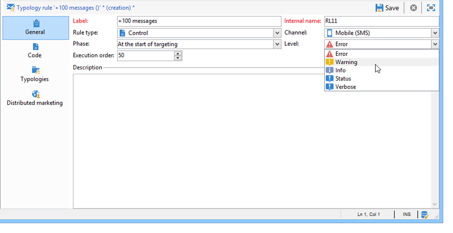
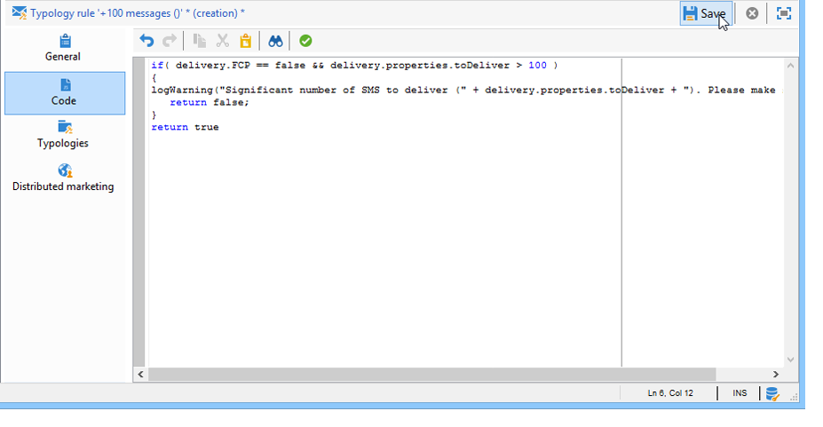
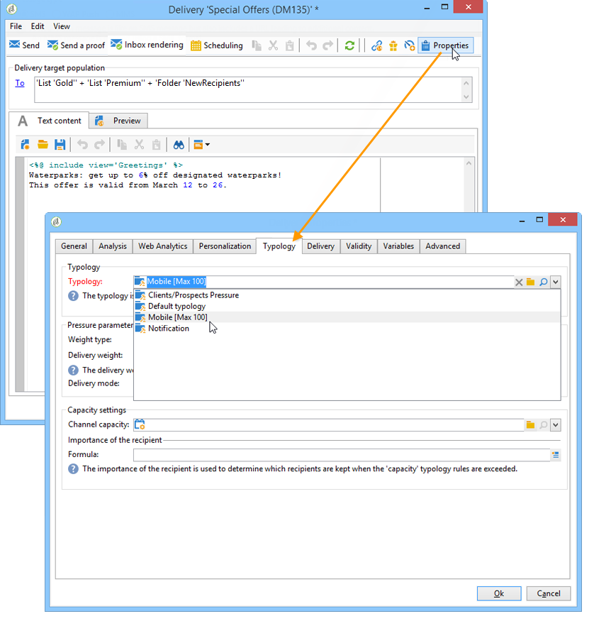
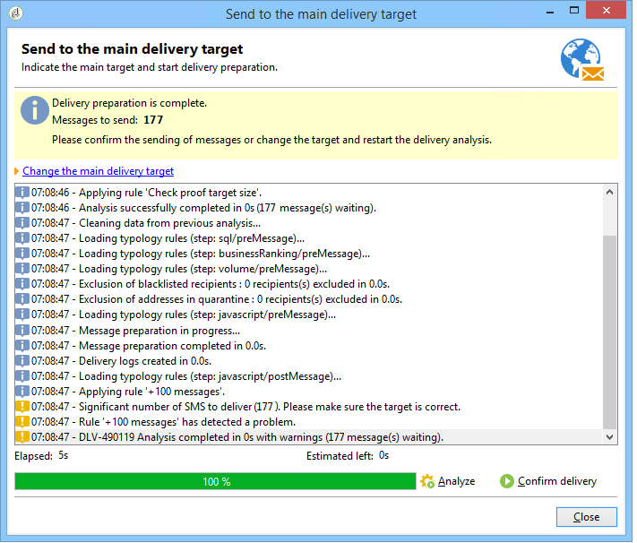
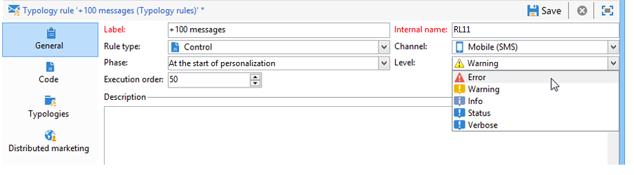
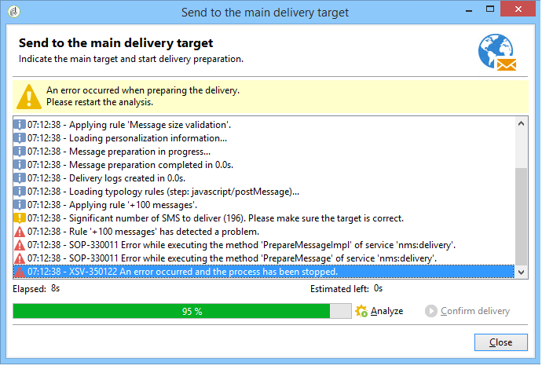

# Regras de controle{#control-rules}

Regras de controle permitem que você garanta a validade e a qualidade das mensagens antes da entrega: exibição de caracteres, tamanho do SMS, formato de endereço etc.

Um conjunto de regras prontas permite que você faça as verificações normais. Essas verificações (mostradas em negrito na interface) são:

* **[!UICONTROL Object approval]** (email): verifica se o objeto e o endereço do remetente não contêm caracteres especiais que podem causar problemas em determinados agentes de email.
* **[!UICONTROL URL label approval]** (email): verifica se cada URL de rastreamento tem um rótulo.
* **[!UICONTROL URL approval]** (email): verifica as URLs de rastreamento (presença do caractere &quot;&amp;&quot;).
* **[!UICONTROL Message size approval]** (dispositivos móveis): verifica o tamanho das mensagens SMS.
* **[!UICONTROL Validity period check]** (email): verifica se o período de validade da entrega é longo o suficiente para enviar todas as mensagens.
* **[!UICONTROL Proof size check]** (todos os canais): gera uma mensagem de erro se a população do target de prova exceder 100 destinatários.
* **[!UICONTROL Wave scheduling check]** (email): verifica se a última onda de entregas está agendada para iniciar antes do fim do período de validade, caso a entrega esteja distribuída em várias ondas.
* **[!UICONTROL Unsubscription link approval]** (email): verifica a presença de pelo menos um URL de cancelamento de subscrição (opt-out) em cada conteúdo (HTML e Text).

## Criar uma regra de controle {#create-a-control-rule}

É possível criar novas regras de controle para atender às suas necessidades. Para fazer isso, crie uma regra de tipologia **[!UICONTROL Control]** e insira a fórmula de controle em SQL na guia **[!UICONTROL Code]**.

**Exemplo:**

No exemplo a seguir, vamos criar uma regra para impedir que uma oferta em SMS seja enviada para mais de 100 destinatários. Essa regra será vinculada a uma tipologia de campanha, em seguida às entregas de SMS para os quais a oferta relacionada estiver disponível.

Siga as etapas abaixo:

1. Crie uma regra de tipologia **[!UICONTROL Control]**. Selecione um nível de alerta **[!UICONTROL Warning]**.

   

1. Na guia **[!UICONTROL Code]**, insira o script para aplicar o limite desejado, conforme mostrado abaixo:

   

   Este script acionará um aviso se o target da entrega exceder 100 contatos:

   ```
   if( delivery.FCP == false && delivery.properties.toDeliver > 100 ) { logWarning("Significant number of SMS to deliver (" + delivery.properties.toDeliver + "). Please make sure the target is correct.") return false; } return true
   ```

1. Vincule esta regra a uma tipologia de campanha e faça referência à tipologia na entrega do SMS em questão.

   

1. Durante a análise da entrega, a regra é aplicada e um aviso é criado se aplicável.

   

   No entanto, a entrega ainda estará pronta para ser enviada.

   Se você aumentar o nível de alerta, isso impedirá que a entrega seja iniciada.

   

   No final da análise, o botão **[!UICONTROL Confirm delivery]** não estará disponível.

   
