# Gerenciar ativos e documentos {#manage-assets-documents}

Você pode associar vários documentos a uma campanha: relatórios, fotos, páginas da Web, diagramas etc. Esses documentos podem estar em qualquer formato.

Em uma campanha também é possível consultar outros itens, como cupons promocionais, ofertas especiais relacionadas a uma marca específica, uma loja etc. Quando esses elementos estão incluídos em uma descrição, é possível associá-los a uma entrega de correspondência direta. [Saiba mais](#associating-and-structuring-resources-linked-via-a-delivery-outline).

>[!CAUTION]
>
>Esse recurso foi projetado para ativos e documentos pequenos.

<!--
>[!NOTE]
>
>If you are using Campaign Marketing Resource Management module, you can also manage a library of marketing resources that are available for several users for collaborative work. [Learn more](../../mrm/using/managing-marketing-resources.md).
-->

## Adicionar documentos {#add-documents}

Os documentos podem ser associados no nível da campanha (documentos contextuais) ou no nível do programa (documentos gerais).

Para uma campanha, a guia **[!UICONTROL Documents]** contém:

* A lista de todos os documentos necessários para o conteúdo (modelo, imagens etc.) que podem ser baixados localmente por operadores do Adobe Campaign com direitos adequados,
* Documentos contendo informações para o roteador, se houver.

Os documentos são vinculados ao programa ou à campanha através da guia **[!UICONTROL Edit > Documents]**.

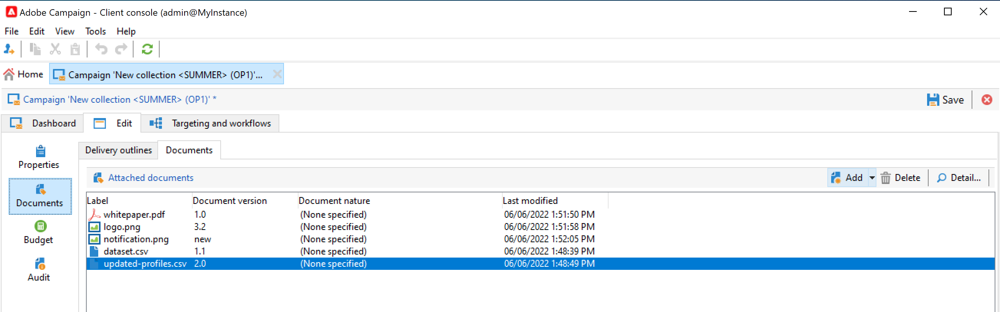

Você também pode adicionar um documento a uma campanha no link dedicado no painel.

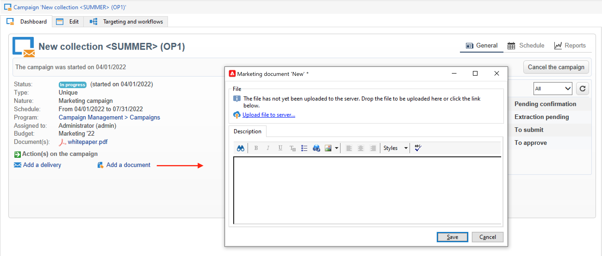

Clique no ícone **[!UICONTROL Detail...]** para exibir o conteúdo de um arquivo e adicionar informações:

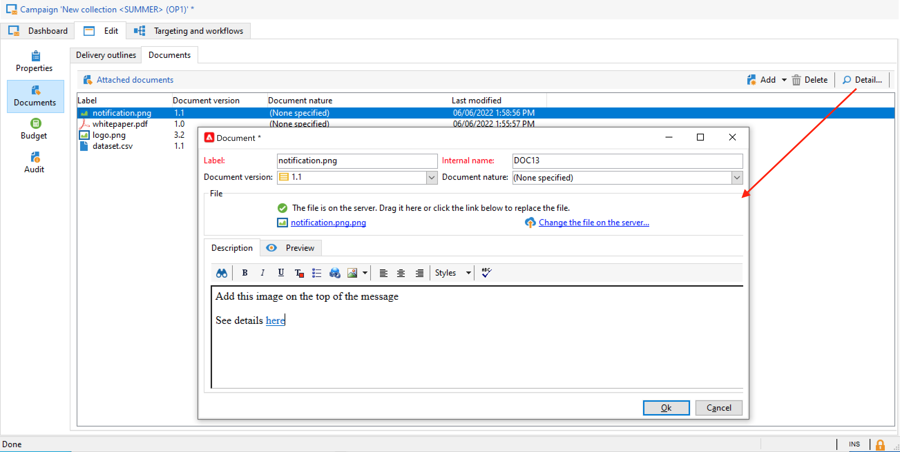

No painel, os documentos associados à campanha são agrupados na seção **[!UICONTROL Document(s)]**, como no exemplo a seguir:

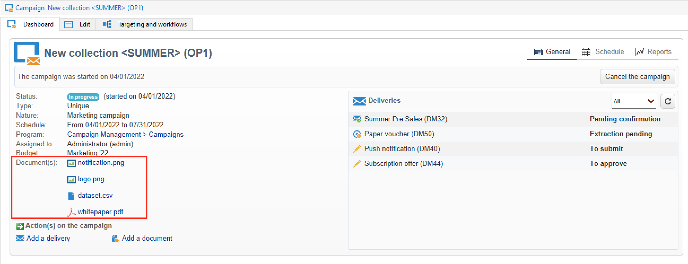

Eles também podem ser editados e modificados nessa visualização.

## Usar delivery outlines {#delivery-outlines}

Um delivery outline é um conjunto estruturado de elementos (documentos, lojas, cupons promocionais etc.) criados pela empresa e para uma campanha específica. Ela é usada no contexto de entregas de correspondência direta.

Esses elementos são agrupados em descrições da entrega, e cada descrição da entrega será associada a uma entrega; ela será referenciada no arquivo de extração enviado para o **provedor de serviço** para ser anexada à entrega. Por exemplo, você pode criar um delivery outline que se refere a uma unidade e aos folhetos de marketing que ela usa.

Para uma campanha, delivery outlines permitem que você estruture elementos externos a serem associados ao delivery de acordo com determinados critérios: unidade relacionada, oferta promocional concedida, convite para um evento local etc.

>[!CAUTION]
>
>Delivery outlines são restritos a campanhas de correspondência direta.

### Criar um delivery outline {#create-an-outline}

Para criar um delivery outline, clique na guia **[!UICONTROL Edit > Documents]** da campanha relacionada e depois clique na subguia **[!UICONTROL Delivery outlines]**.

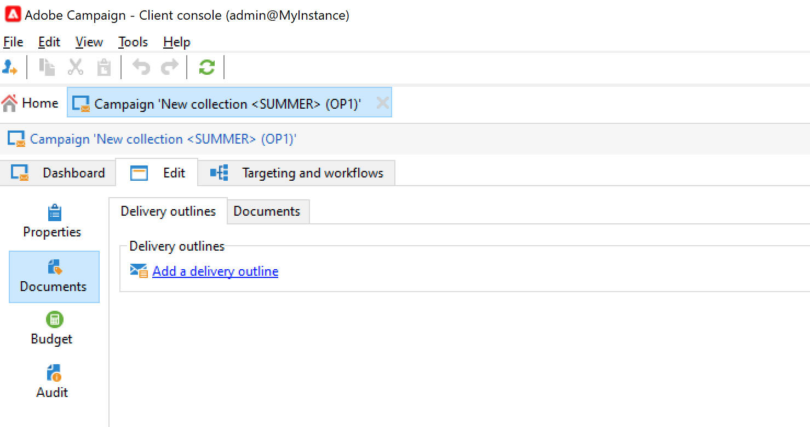

>[!NOTE]
>
>Se não for possível ver essa guia, significa que esse recurso não está disponível para essa campanha ou que o delivery de correspondência direta não está ativado em sua instância. Consulte a [configuração do modelo de campanha](marketing-campaign-templates.md#campaign-templates) ou o contrato de licença.

Em seguida, clique em **[!UICONTROL Add a delivery outline]** e crie a hierarquia de outlines para a campanha:

1. Clique com o botão direito do mouse na raiz da árvore e selecione **[!UICONTROL New > Delivery outlines]**.
1. Clique com o botão direito do mouse no outline recém criado e selecione **[!UICONTROL New > Item]** ou **[!UICONTROL New > Personalization fields]**.

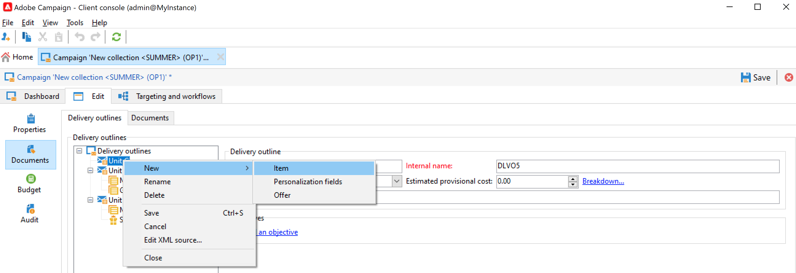

Uma estrutura pode conter itens, campos de personalização e ofertas:

* Os itens podem ser documentos físicos, por exemplo, que são referenciados e descritos aqui e serão anexados à entrega.
* Os campos de personalização permitem que você crie elementos de personalização relacionados a remessas em vez de destinatários. Assim, é possível criar valores a serem utilizados em entregas para um público-alvo específico (oferta de boas-vindas, desconto etc.) Elas são criadas no Adobe Campaign e importadas para a estrutura por meio do link **[!UICONTROL Import personalization fields...]**.

  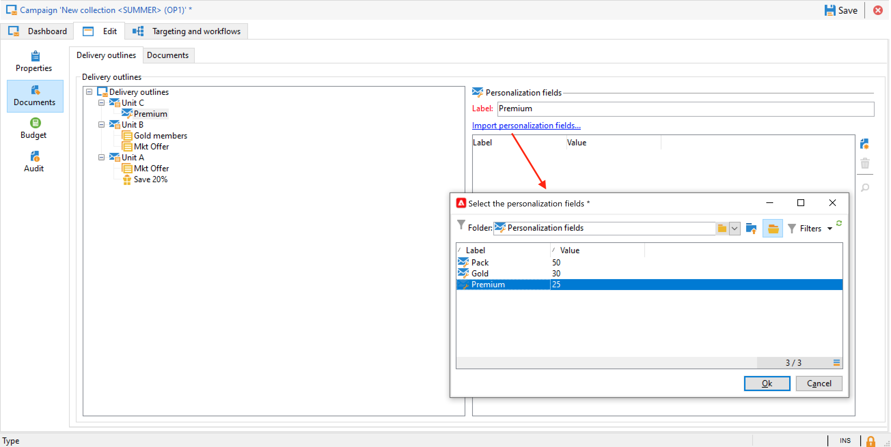

  Eles também podem ser criados diretamente na estrutura clicando no ícone **[!UICONTROL Add]** à direita da zona de lista.

  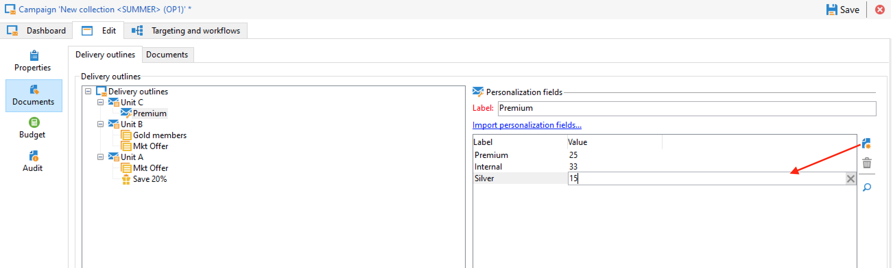

### Selecionar um outline {#select-an-outline}

Para cada entrega, você pode selecionar o outline para associar na seção reservada para o outline da extração, como no exemplo a seguir:

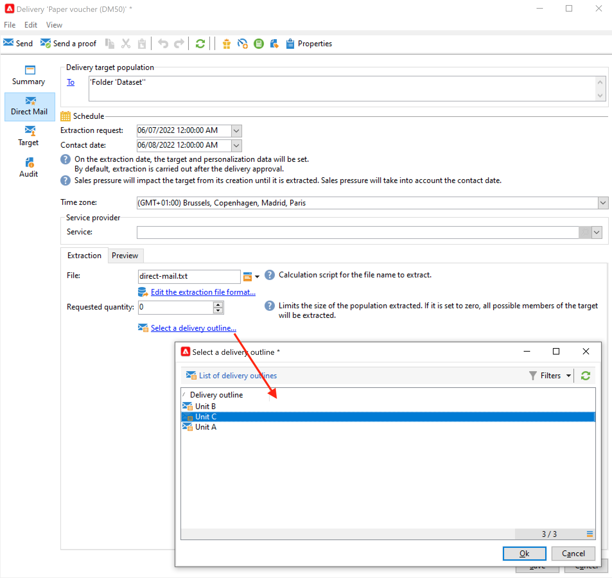

A estrutura selecionada é então exibida na seção inferior da janela. Ele pode ser editado usando o ícone à direita do campo ou alterado usando a lista suspensa:

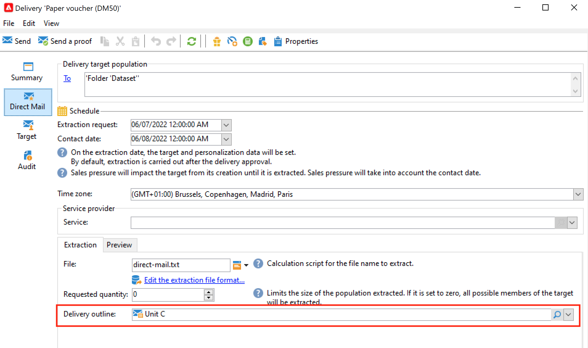

A guia **[!UICONTROL Summary]** da entrega também exibe essas informações:

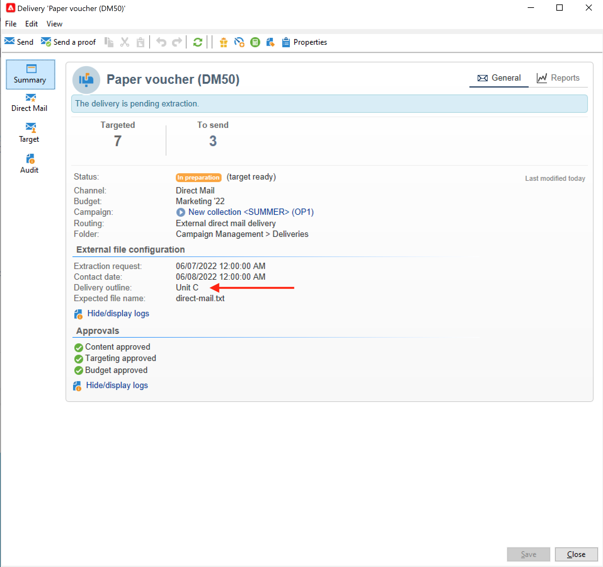

### Resultado da extração {#extraction-result}

No arquivo extraído e enviado ao provedor de serviços, o nome da estrutura e, quando apropriado, suas características (custo, descrição etc.) são adicionados ao conteúdo de acordo com as informações no modelo de exportação associado ao provedor de serviços.

No seguinte exemplo, o rótulo, custo estimado e descrição do outline associado à entrega serão adicionados no arquivo de extração.

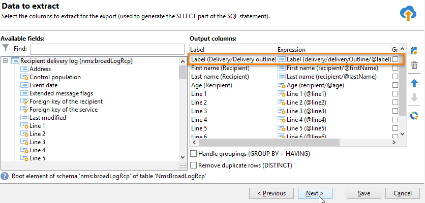

O modelo de exportação deve estar associado ao provedor de serviços selecionado para a entrega. Consulte [esta seção](providers-stocks-and-budgets.md#create-service-providers-and-their-cost-structures).
