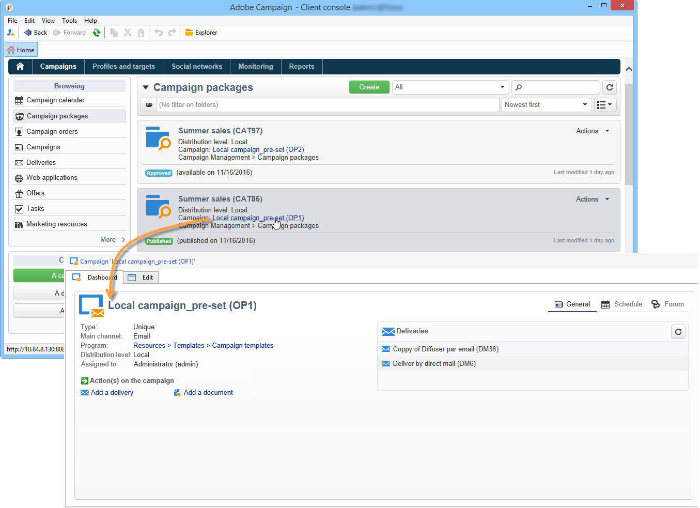

# Acessar campanhas{#accessing-campaigns}

Uma vez que uma campanha foi solicitada, o pedido foi aprovado e a data de disponibilidade foi atingida, ela pode ser executada.

Dependendo do tipo de campanha e das opções selecionadas, a campanha é executada localmente ou centralmente.

## Acessar a campanha {#accessing-the-campaign}

Quando o pedido for aprovada e a data de disponibilidade for atingida, a campanha será criada localmente e poderá ser usada. Os operadores locais são notificados sobre sua disponibilidade.

É adicionado ao detalhe do pedido correspondente e pode ser editado. O painel completo permite o gerenciamento em um nível local.

A campanha permanece acessível na visão geral do Campaign, localizada no link **[!UICONTROL Campaigns]** na página inicial.

## Configurações disponíveis {#available-settings}

As entidades locais podem adaptar o conteúdo da campanha de acordo com suas necessidades, usando todos os elementos do painel de campanha. Sua principal tarefa será adaptar o fluxo de trabalho de segmentação e possivelmente personalizar o conteúdo da entrega.

## Execução da campanha {#campaign-execution}

Cada entidade local pode executar o fluxo de trabalho da campanha e executar as aprovações necessárias com base no processo definido no modelo da campanha.
