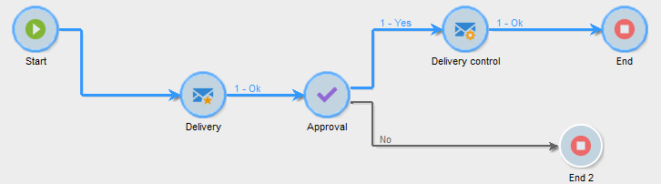
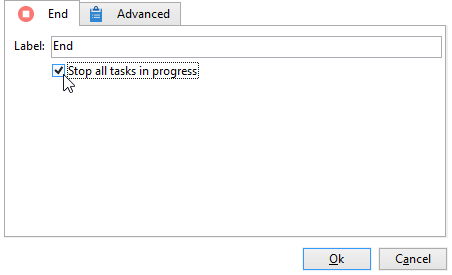
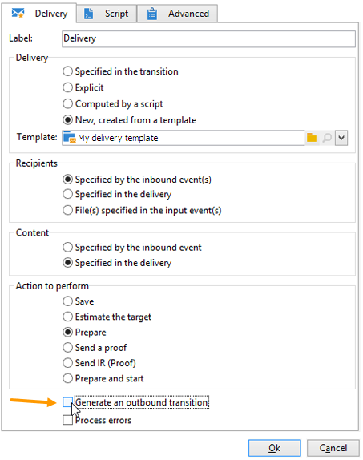

# Início e término{#start-and-end}

As atividades **[!UICONTROL Start]** e **[!UICONTROL End]** permitem marcar graficamente o início e o fim de um fluxo de trabalho. Essas atividades não têm impacto funcional e, portanto, são opcionais.

* **[!UICONTROL Start]**

  A execução de um fluxo de trabalho começa com atividades sem uma transição de entrada e atividades tipo início.

  

* **[!UICONTROL End]**

  É possível configurar a atividade **[!UICONTROL End]** para interromper todas as tarefas em andamento. Para fazer isso, clique duas vezes na atividade para exibir suas propriedades e marque a opção apropriada.

  

  Os dados na tabela de trabalho são excluídos automaticamente quando a atividade final é habilitada. Se isso não for necessário e para evitar cargas desnecessárias, é possível desabilitar a transição na última saída de atividade. Por exemplo, em uma saída de remessa, se nenhum processo estiver agendado, desmarque a opção relevante conforme mostrado abaixo:

  
