# Usar dados de fluxo de trabalho{#how-to-use-workflow-data}

Você pode usar atividades de workflow para executar várias tarefas. Encontre abaixo exemplos de uso para atualizar o banco de dados criando listas, gerenciar assinaturas, enviar mensagens por meio de um fluxo de trabalho ou enriquecer seus deliveries e seus públicos.

Um conjunto de casos de uso de fluxo de trabalho está disponível em [Casos de uso de fluxo de trabalho](workflow-use-cases.md).

## Ciclo de vida dos dados {#data-life-cycle}

### Tabela de trabalho temporário do fluxo de trabalho {#work-table}

Nos fluxos de trabalho, os dados transportados de uma atividade para outra são armazenados em uma tabela de trabalho temporária.

Esses dados podem ser exibidos e analisados clicando com o botão direito do mouse na transição apropriada.

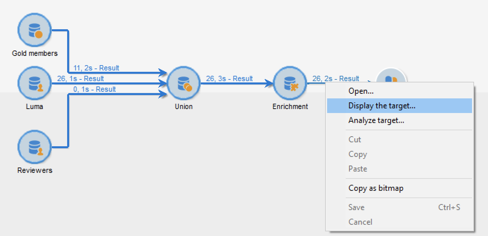

Para fazer isso, selecione o menu relevante:

* **[!UICONTROL Display the target...]**

  Esse menu exibe os dados disponíveis sobre o público-alvo.

  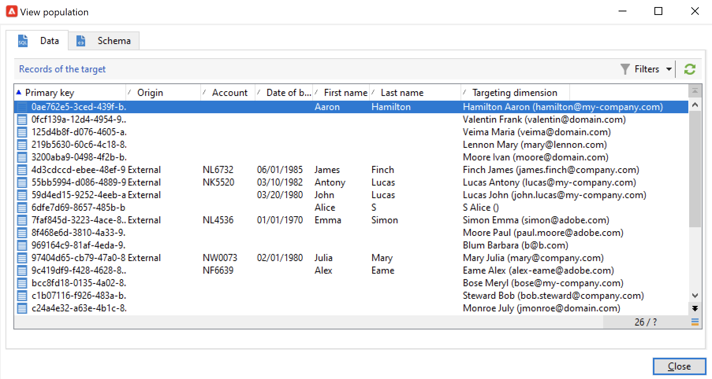

  Você pode acessar a estrutura da tabela de trabalho na guia **[!UICONTROL Schema]**.

  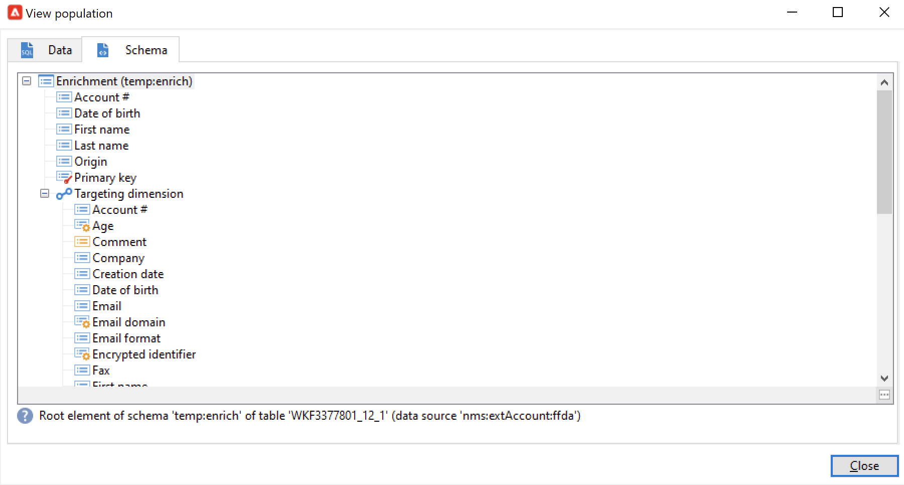

  Para obter mais informações, consulte [Tabelas de trabalho e esquema de fluxo de trabalho](monitor-workflow-execution.md#worktables-and-workflow-schema).

* **[!UICONTROL Analyze target...]**

  Use esse menu para acessar o assistente de análise descritiva que permite gerar estatísticas e relatórios sobre os dados de transição.

  Saiba como usar o assistente de análise descritiva na [documentação do Campaign Classic v7](https://experienceleague.adobe.com/docs/campaign-classic/using/reporting/analyzing-populations/about-descriptive-analysis.html?lang=pt-BR){target="_blank"}.

Os dados do target são descartados na execução do fluxo de trabalho Somente a última tabela de trabalho está acessível. Você pode configurar o fluxo de trabalho para que todas as tabelas de trabalho permaneçam acessíveis: marque a opção **[!UICONTROL Keep the result of interim populations between two executions]** nas propriedades do fluxo de trabalho.

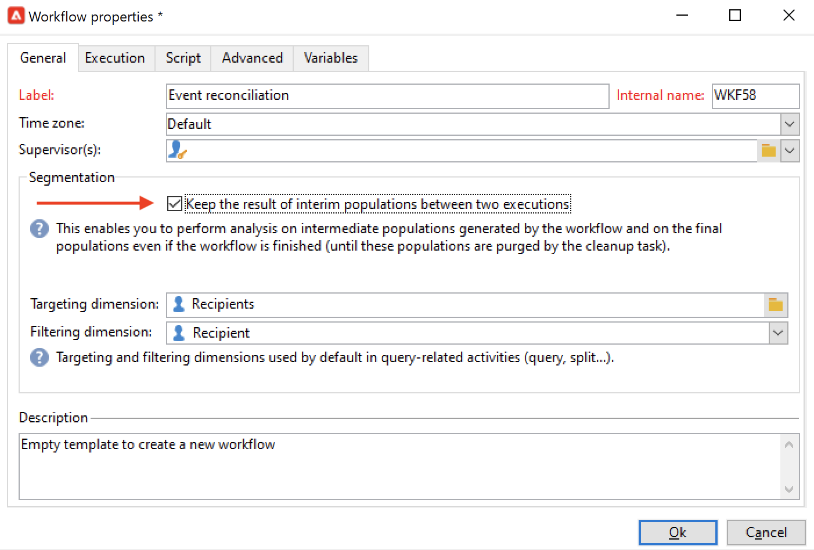

>[!CAUTION]
>
>Essa opção **nunca** deve ser selecionada em um fluxo de trabalho de **produção**. Essa opção é usada para analisar os resultados e é projetada apenas para fins de teste e, portanto, deve ser usada apenas em ambientes de desenvolvimento ou de preparo.


### Aproveitar os dados de destino {#target-data}

Os dados armazenados na tabela de trabalho temporária do workflow estão disponíveis para tarefas de personalização. Os dados podem ser usados nos [campos de personalização](../../v8/send/personalization-fields.md).

Isso permite usar dados coletados por uma lista em um delivery, por exemplo. Para fazer isso, use a seguinte sintaxe:

```
%= targetData.FIELD %
```

Os elementos de personalização do tipo **[!UICONTROL Target extension]** (targetData) não estão disponíveis para fluxos de trabalho de direcionamento. O target da entrega deve ser construído no fluxo de trabalho e especificado na transição de entrada da entrega.

No exemplo a seguir, você está coletando uma lista de informações sobre clientes, para serem usadas em um email personalizado. Siga as etapas abaixo:

1. Crie um fluxo de trabalho para coletar informações, reconcilie com os dados já existentes no banco de dados, e depois inicie uma entrega.

   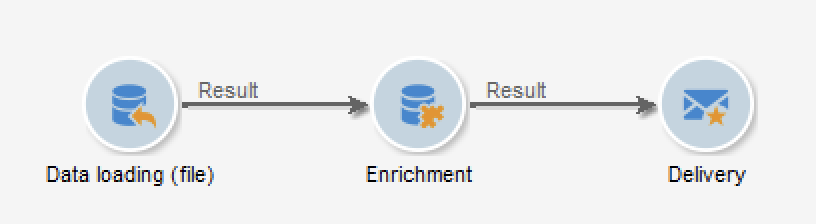

1. No nosso exemplo, o conteúdo do arquivo é o seguinte:

   ```
   Music,First name,Last name,Account,CD/DVD,Card
   Pop,David,BLAIR,4323,CD,0
   Rock,Daniel,ARCARI,3222,DVD,1
   Disco,Uma,ALTON,0488,DVD,0
   Jazz,Paul,BOLES,6475,CD,1
   Jazz,David,BOUKHARI,0841,DVD,1
   [...]
   ```

   Para carregar o arquivo, configure a atividade **[!UICONTROL Data loading (file)]** conforme abaixo:

   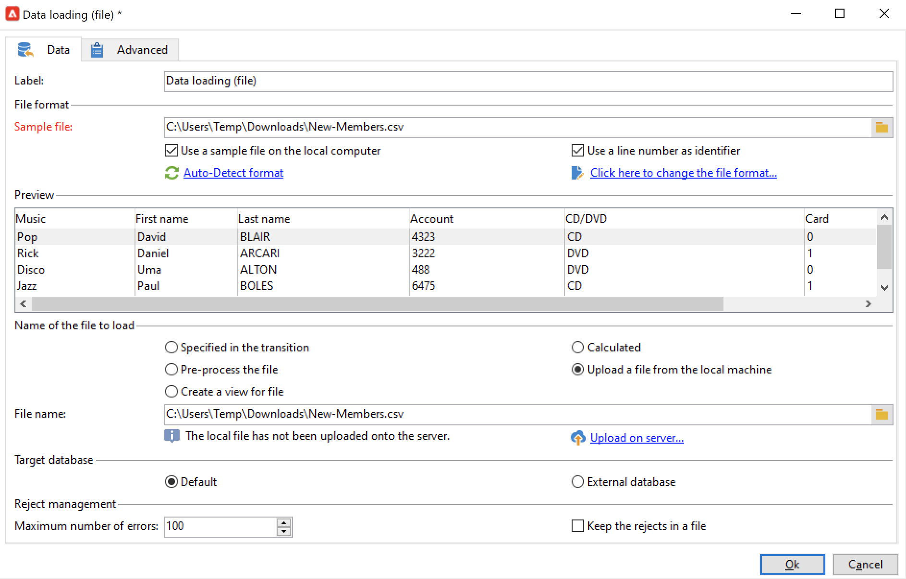

1. Configure a atividade **[!UICONTROL Enrichment]** para reconciliar os dados coletados com os existentes no banco de dados do Adobe Campaign. Aqui, a chave de reconciliação é o número da conta:

   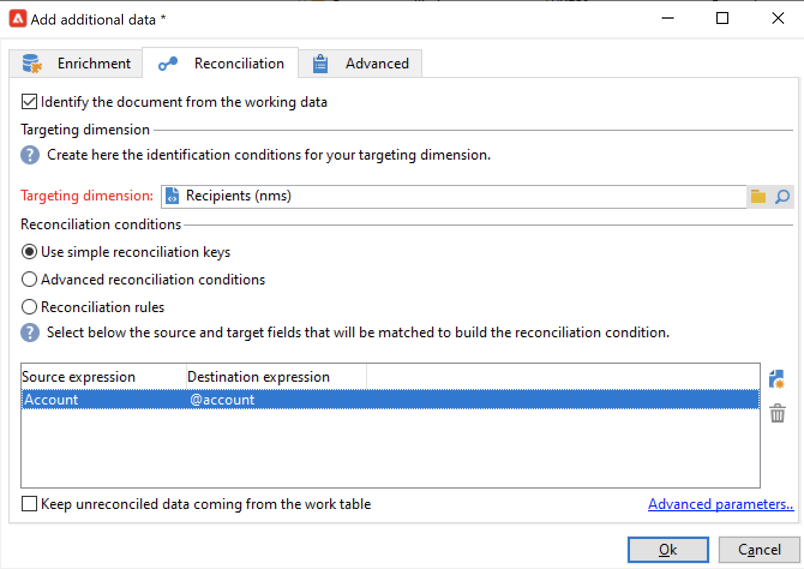

1. Em seguida, configure o **[!UICONTROL Delivery]**: ele é criado com base em um modelo e os destinatários são especificados pela transição de entrada.

   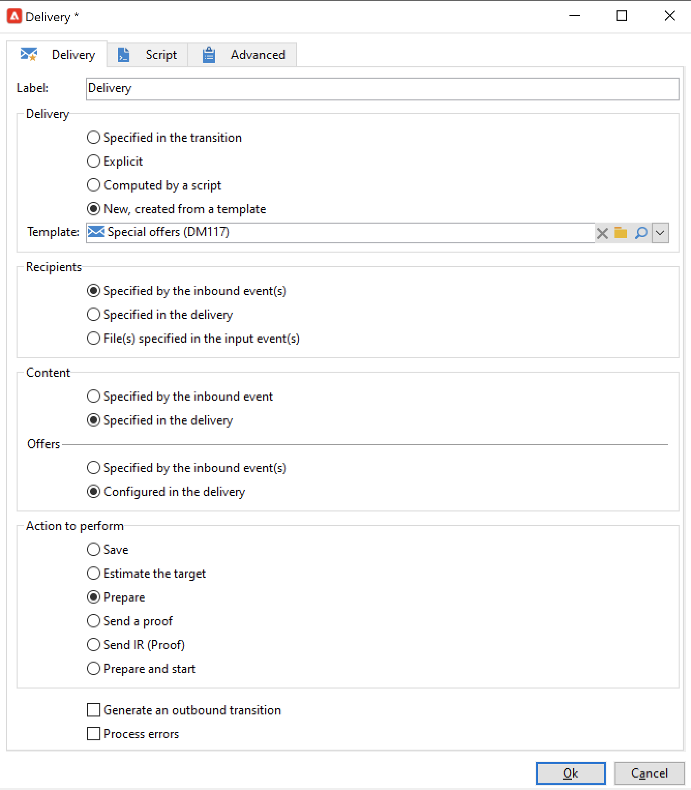

   >[!CAUTION]
   >
   >Somente os dados contidos na transição podem ser usados para personalizar a entrega. Os campos de personalização do tipo **targetData** só estão disponíveis para a população de entrada da atividade de **[!UICONTROL Delivery]**.

1. No modelo de entrega, use os campos coletados no fluxo de trabalho.

   Para fazer isso, insira os campos de personalização do tipo **[!UICONTROL Target extension]**.

   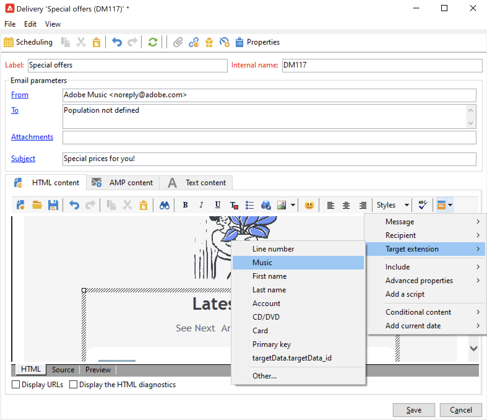

   Nesse exemplo, queremos inserir o gênero de música e o tipo de mídia favoritos do cliente (CD ou DVD), conforme declarado no arquivo coletado pelo fluxo de trabalho.

   Como um diferencial, vamos adicionar um cupom para os titulares de cartões de fidelidade, ou seja, destinatários para os quais o valor &#39;Cartão&#39; for igual a 1.

   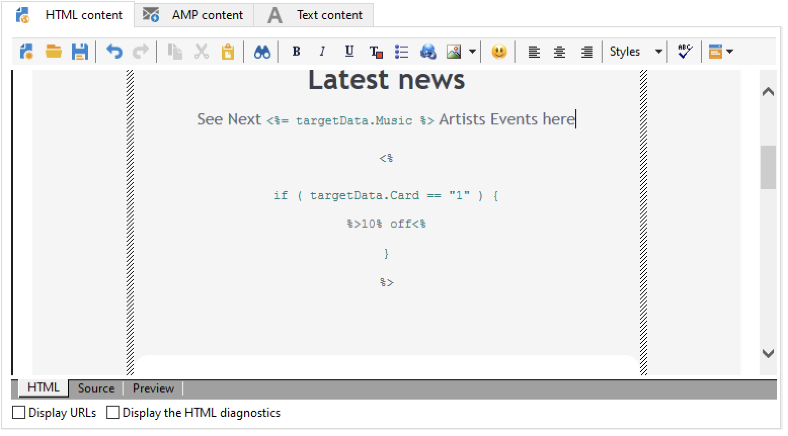

   Os dados do tipo **[!UICONTROL Target extension]** (targetData) são inseridos em entregas usando as mesmas características de todos os campos de personalização. Eles também podem ser usados no assunto, rótulos de link ou nos próprios links.


## Atualizar o banco de dados {#update-the-database}

Todos os dados coletados podem ser usados para atualizar o banco de dados ou nas entregas. Por exemplo, você pode enriquecer as possibilidades de personalização do conteúdo da mensagem (incluir o número de contratos na mensagem, especificar o valor médio das compras no ano passado etc.) ou detalhar a segmentação de população (enviar uma mensagem aos cotitulares do contrato, direcionar os 1.000 principais assinantes para serviços online etc.). Esses dados também podem ser exportados ou arquivados em uma lista.

### Atualizar listas  {#list-updates}

Os dados do banco de dados do Adobe Campaign e as listas existentes podem ser atualizados usando duas atividades dedicadas:

* A atividade de **[!UICONTROL List update]** permite armazenar tabelas de trabalho num DataList.

  Você pode selecionar uma lista existente ou criar uma. Nesse caso, o nome e possivelmente a pasta de registro são calculados.

  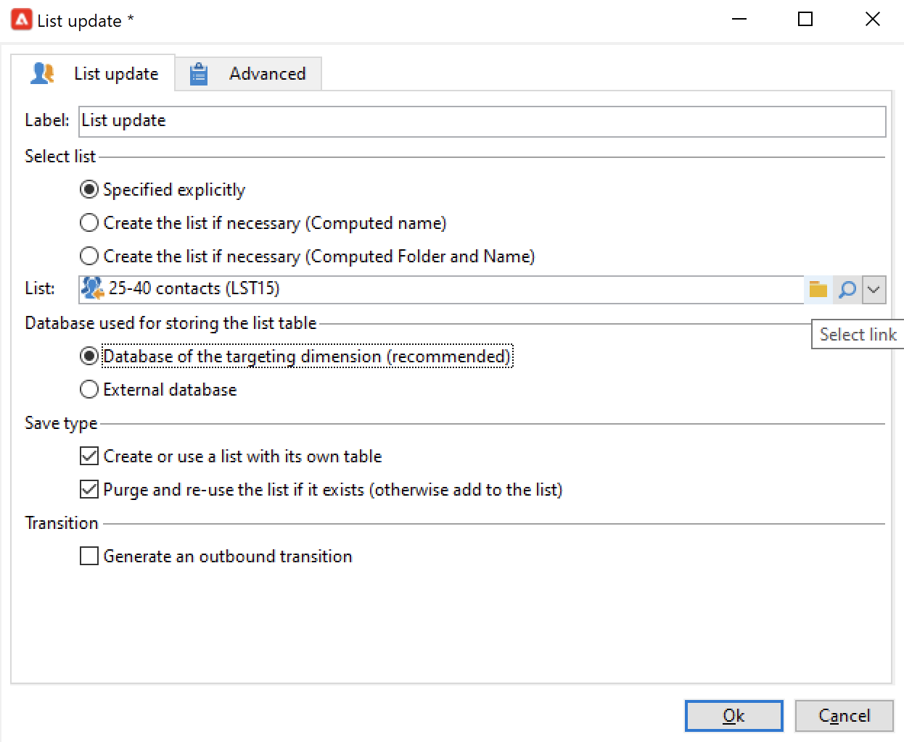

  Consulte [Atualização da lista](list-update.md).

* A atividade **[!UICONTROL Update data]** realiza uma atualização em massa dos campos no banco de dados.

  Para mais informações, consulte [Atualização de dados](update-data.md).

### Gerenciar assinaturas {#subscription-management}

Para saber mais sobre subscrição e cancelamento de subscrição de destinatários de um serviço de informações via fluxo de trabalho, consulte [Serviços de subscrição](subscription-services.md).
