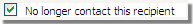

# CheckBox

Botão a ser marcado.

## Propriedades

**backColor - cadeia de caracteres** Cor de fundo (btnshadow, branco).

**borda - cadeia de caracteres** Altera o estilo de estrutura de tópicos de controle (sólido, duplo, margem interna, início, nenhum).

**checkedValue - string** XPath que fornece o rótulo do botão.

**tamanho da fonte - inteiro** Altera o tamanho da fonte.

**rótulo - cadeia de caracteres** Rótulo associado.

**nolabel - booleano** oculta o rótulo associado.

**readOnly - booleano** Força o controle a ser somente leitura.
