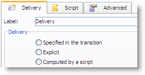

# Bloco de notas

Lista de guias para exibir várias páginas.



## Propriedades

**backColor - cadeia de caracteres** Cor de fundo (btnshadow, branco).

**nome - cadeia de caracteres** ID do Contêiner.

**preenchimento-esquerda - inteiro** Espaço em pixel à esquerda do contêiner.

**preenchimento à direita - inteiro** Espaço em pixel à direita do contêiner.

**padding-top - inteiro** Espaço em pixel acima do contêiner.

**margin-bottom - inteiro** Espaço em pixels abaixo do contêiner.

**preenchimento - inteiro** Espaço em pixel ao redor do contêiner.

**readOnly - booleano** Força o controle e todos os seus descendentes a somente leitura.

**style - string** flat \| down \| up (padrão).

## Observações

Cada subelemento representa uma página. Exemplos:

```xml
      <container colspan="2" style="down" type="notebook">
   <container label="Products">
     ...
   </container>

   <container colcount="3" xpath="link">
     ...
   </container>

   <container xpath="linkCollection">
     ...
   </container>
 </container>
```
