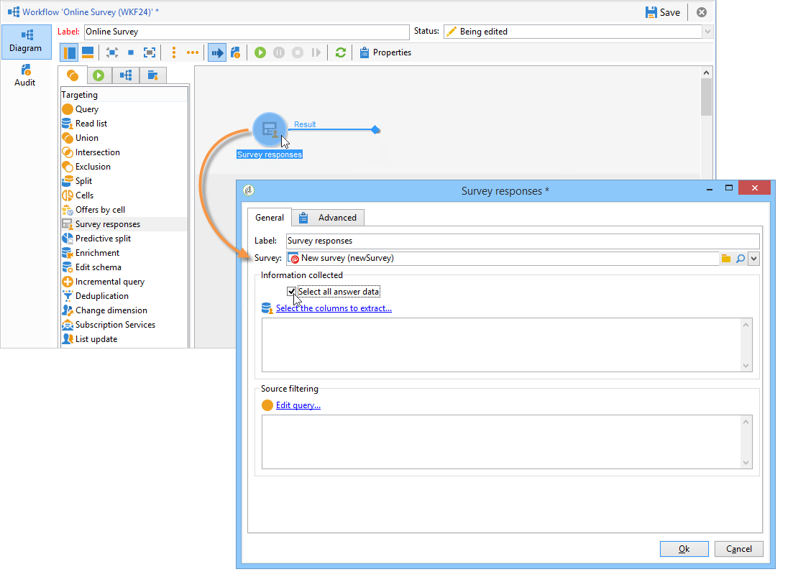
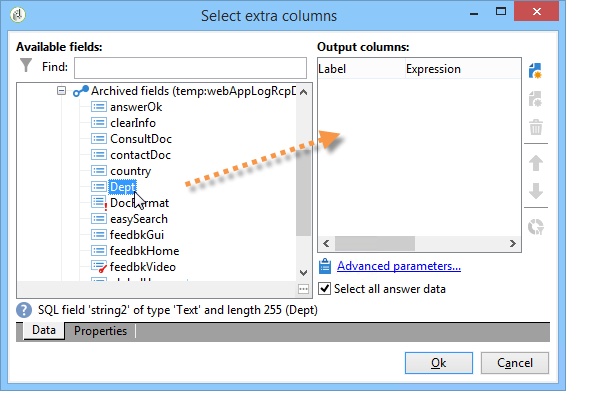
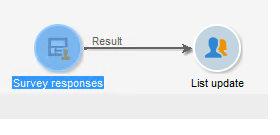
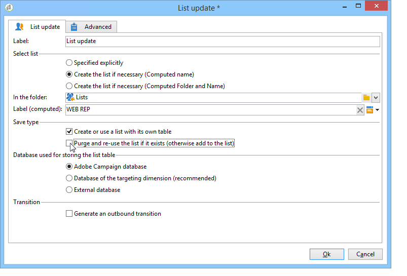
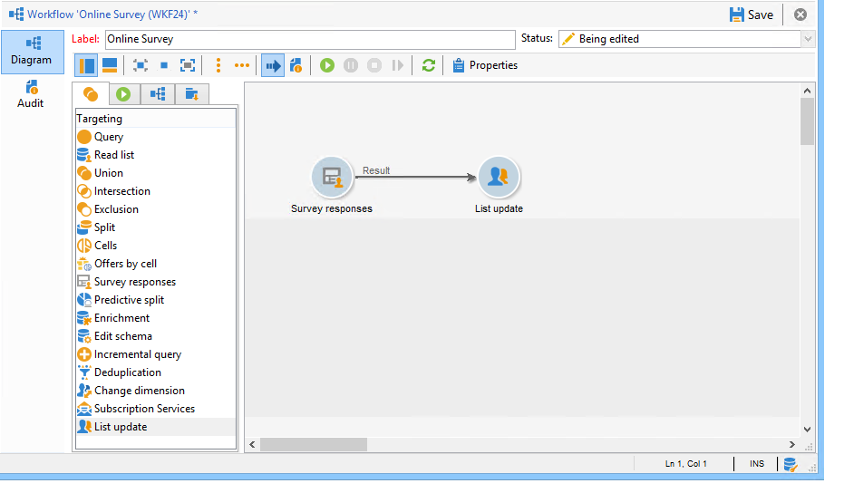
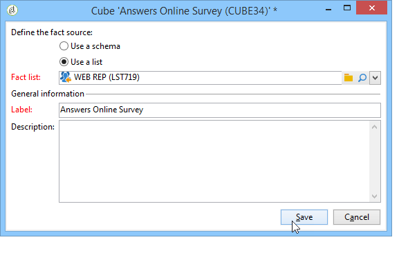
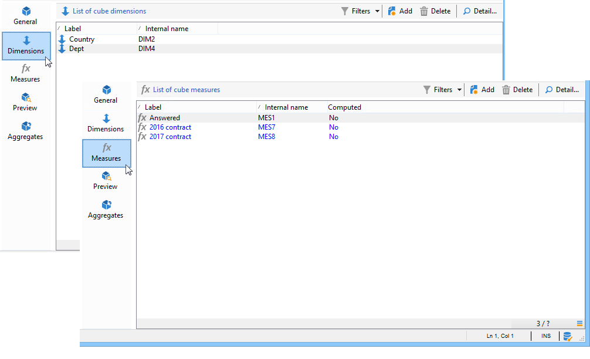
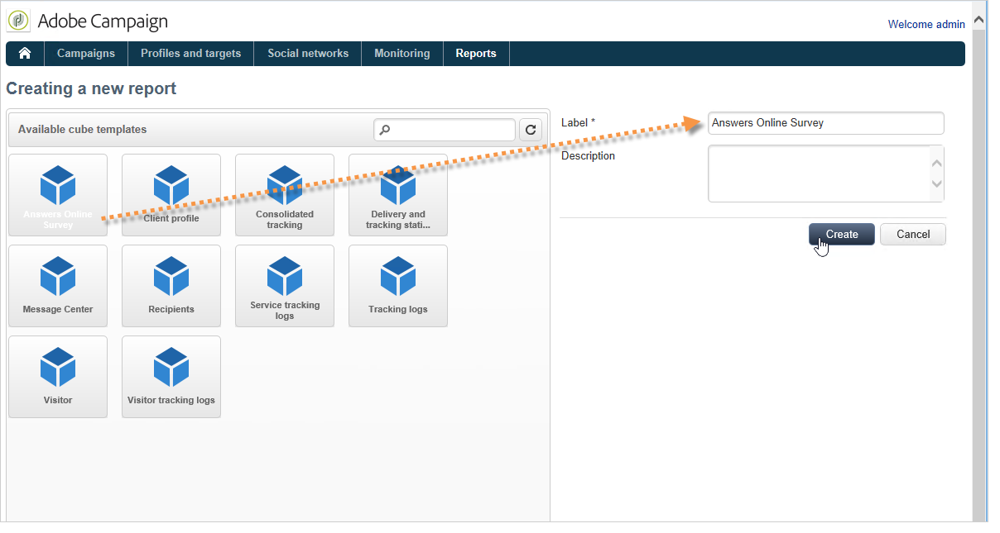
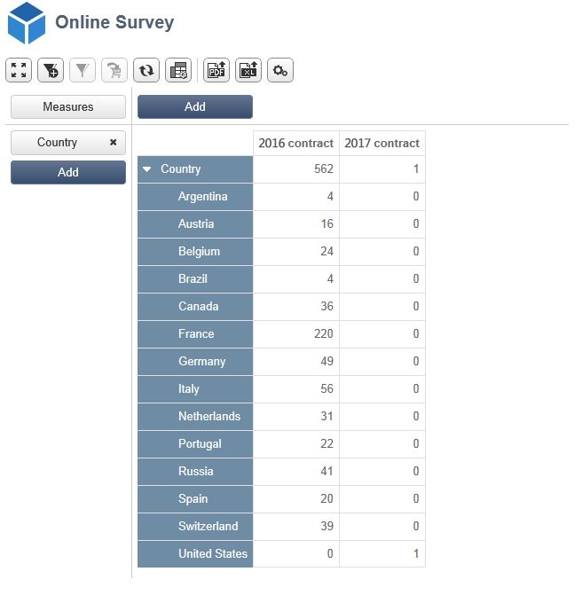

# Caso de uso: exibição do relatório sobre as respostas de uma pesquisa online{#use-case-displaying-report-on-answers-to-an-online-survey}

>[!AVAILABILITY]
>
>As pesquisas não estão disponíveis para [implantações do FFDA do Campaign](../../architecture/enterprise-deployment.md).

As respostas às pesquisas do Adobe Campaign podem ser coletadas e analisadas usando relatórios dedicados.

No exemplo a seguir, queremos coletar respostas de uma pesquisa online e exibi-las em uma tabela dinâmica.

Siga as etapas abaixo:

1. Criação de um fluxo de trabalho para recuperar as respostas à pesquisa e armazená-las em uma lista.
1. Criação de um cubo usando os dados na lista.
1. Criação de um relatório com a tabela dinâmica e visualização do detalhamento das respostas.

Antes de começar neste caso de uso, é preciso ter acesso a uma pesquisa e um conjunto de respostas para analisar.

>[!NOTE]
>
>Esse caso de uso só poderá ser implementado se tiver adquirido a opção **Survey Manager.** Verifique o contrato de licença.

## Etapa 1 — criação da coleção de dados e do fluxo de trabalho de armazenamento {#step-1---creating-the-data-collection-and-storage-workflow}

Para coletar as respostas da pesquisa, siga as etapas abaixo:

1. Crie um fluxo de trabalho e coloque uma atividade **[!UICONTROL Answers to a survey]**. Para obter mais informações sobre como usar esta atividade, consulte [Como usar os dados coletados](publish-track-and-use-collected-data.md#using-the-collected-data).
1. Edite a atividade e selecione a pesquisa cujas respostas deseja analisar.
1. Habilite a opção **[!UICONTROL Select all the answer data]** para coletar todas as informações.

   

1. Selecione as colunas a serem extraídas (nesse caso, selecione todos os campos arquivados). Esses são os campos que contêm as respostas.

   

1. Depois que a caixa de coleção de resposta estiver configurada, posicione uma atividade do tipo **[!UICONTROL List update]** para salvar os dados.

   

   Nesta atividade, especifique a lista que deve ser atualizada e desmarque a opção **[!UICONTROL Purge and re-use the list if it exists (otherwise add to the list)]**: as respostas são adicionadas à tabela existente. Essa opção permitirá fazer referência à lista em um cubo. O esquema vinculado à lista não será recriado em cada atualização, o que garante a integridade do cubo que usa essa lista.

   

1. Inicie o fluxo de trabalho para confirmar sua configuração.

   

   A lista especificada é criada e inclui o esquema das respostas da pesquisa.

1. Adicione um programador para automatizar a coleta diária das respostas e a atualização da lista.

   As atividades **[!UICONTROL List update]** e **[!UICONTROL Scheduler]** estão detalhadas em .

## Etapa 2 — criação do cubo, suas medidas e seus indicadores {#step-2---creating-the-cube--its-measures-and-its-indicators}

É possível então criar o cubo e configurar suas medidas: elas serão usados para criar os indicadores que serão mostrados no relatório. Para obter mais informações sobre a criação e configuração de cubos, consulte [Sobre os cubos](https://experienceleague.adobe.com/en/docs/campaign-classic/using/reporting/ac-cubes){target="_blank"}.

Neste exemplo, o cubo se baseia nos dados da lista alimentados pelo fluxo de trabalho criado anteriormente.

Defina as dimensões e as medidas a serem exibidas no relatório. Aqui, queremos exibir a data do contrato e o país do entrevistado.

A guia **[!UICONTROL Preview]** permite controlar a renderização do relatório.

## Etapa 3 — criação do relatório e configuração do layout de dados na tabela {#step-3---creating-the-report-and-configuring-the-data-layout-within-the-table}

Em seguida, é possível criar um relatório com base nesse cubo e processar os dados e informações.

Adapte as informações a serem exibidas com base nas suas necessidades.

