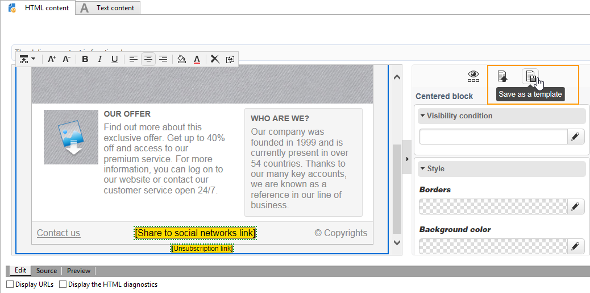

# Gerenciamento de modelo{#template-management}

O Editor de conteúdo digital oferece **modelos padrão** para aplicações web e entregas.

Ao criar uma aplicação web tipo Página de destino, o usuário pode escolher um desses modelos. Você também pode importar um modelo HTML criado fora do Adobe Campaign.

Para adicionar um modelo, consulte [Opções globais](content-editor-interface.md#global-options).

## Salvar uma entrega como modelo {#saving-a-delivery-as-a-template}

Após configurar uma entrega, você pode salvá-la como modelo e reutilizá-la em entregas futuras.

Na guia **Campanhas**, abra a entrega escolhida. Clique no botão **Salvar como modelo**, nomeie o modelo e salve.

O novo template é salvo no nó **Resources > Templates > Content models** no explorer.
