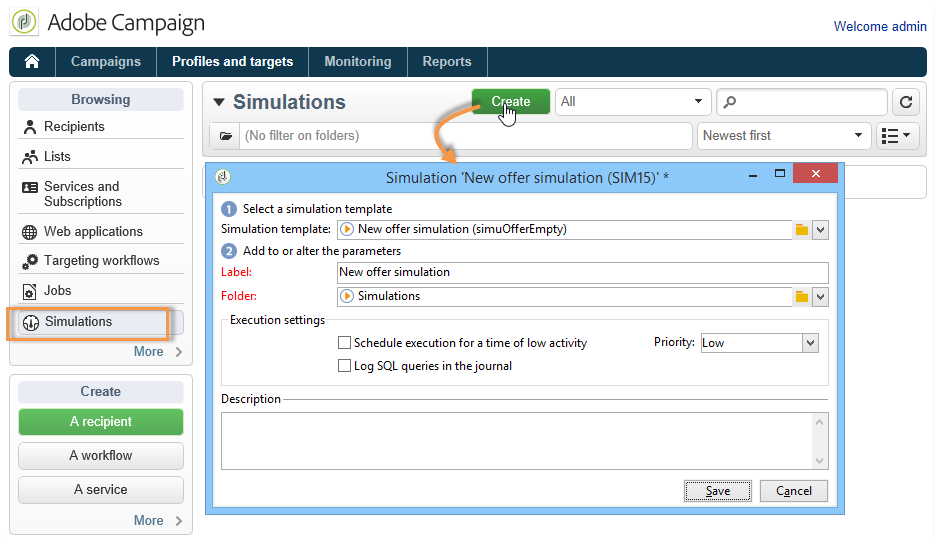
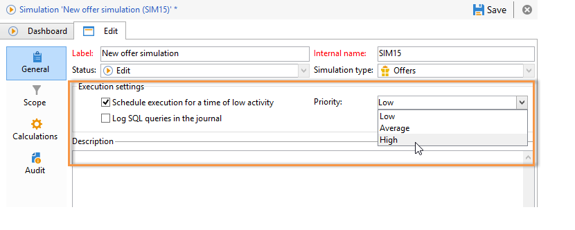
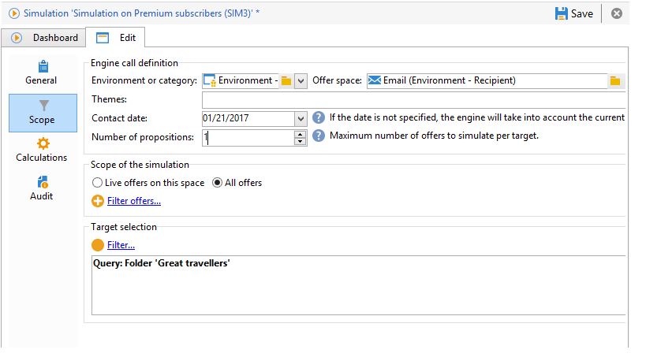
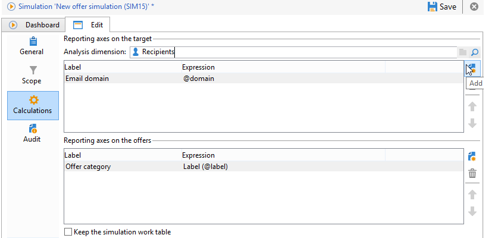
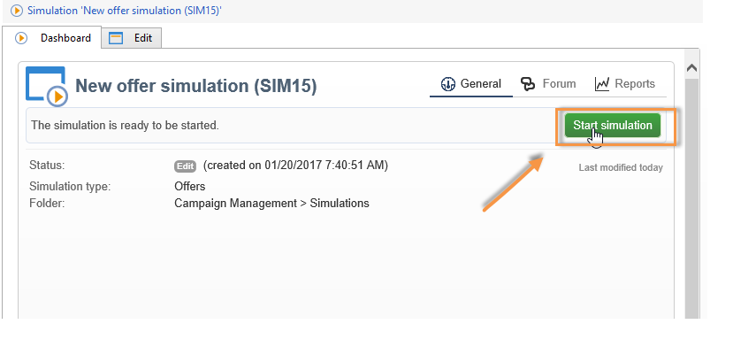
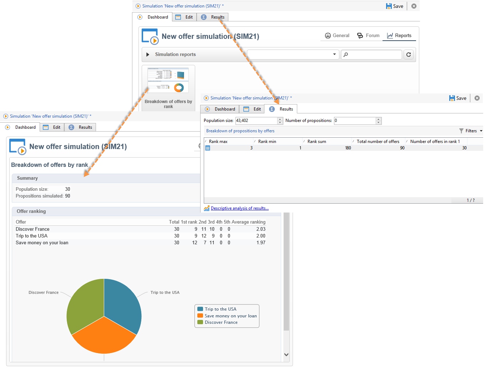

# Sobre a simulação de ofertas{#about-offers-simulation}

O módulo **Simulation** permite testar a distribuição de ofertas pertencentes a uma categoria ou um ambiente antes de enviar sua proposta para os destinatários.

A simulação leva em consideração os contextos e as regras de elegibilidade aplicadas anteriormente às ofertas (consulte [Visão geral do catálogo de ofertas](https://experienceleague.adobe.com/pt-br/docs/campaign/campaign-v8/offers/interaction-offer-catalog){target="_blank"} na documentação do Campaign v8), bem como suas regras de apresentação (consulte [Gerenciar a apresentação de ofertas](managing-offer-presentation.md)). Isso permite testar e refinar várias versões da apresentação de oferta sem realmente usar uma oferta ou sobrecarregar ou não um destino, já que a simulação não tem impacto nos destinatários de destino.

Para saber como simular uma oferta, leia as etapas abaixo.

[ Você também pode assistir a este vídeo](https://helpx.adobe.com/campaign/classic/how-to/simulate-offer-in-acv6.html?playlist=/ccx/v1/collection/product/campaign/classic/segment/digital-marketers/explevel/intermediate/applaunch/introduction/collection.ccx.js&ref=helpx.adobe.com).

## Etapas principais para a criação de uma simulação {#main-steps-for-creating-a-simulation}

Para criar uma simulação de suas ofertas, aplique as seguintes etapas:

1. Na guia **[!UICONTROL Profiles and Targets]**, clique no link **[!UICONTROL Simulations]** e depois clique no botão **[!UICONTROL Create]**.

   

1. Salve e edite a simulação que acabou de criar.
1. Vá para a guia **[!UICONTROL Edit]** e especifique as configurações de execução.

   Para obter mais informações, consulte [Configurações de execução](execution-settings.md).

   

   >[!NOTE]
   >
   >As configurações de execução só estarão disponíveis se estiver usando o Interaction com o Campaign.

1. Especifique o escopo da simulação.

   Para obter mais informações, consulte [Definição do escopo](simulation-scope.md#definition-of-the-scope).

   

1. Adicione eixos de relatórios para aprimorar o relatório **[!UICONTROL Offer distribution by rank]** (opcional).

   Para obter mais informações, consulte [Adição de eixos de relatórios](simulation-scope.md#adding-reporting-axes).

   

1. Clique em **[!UICONTROL Save]** para gravar as configurações da simulação.
1. Inicie a simulação através do painel.

   

1. Verifique o resultado da simulação e exiba o relatório de análise.

   Para obter mais informações, consulte [Rastreamento de simulação](simulation-tracking.md).

   
