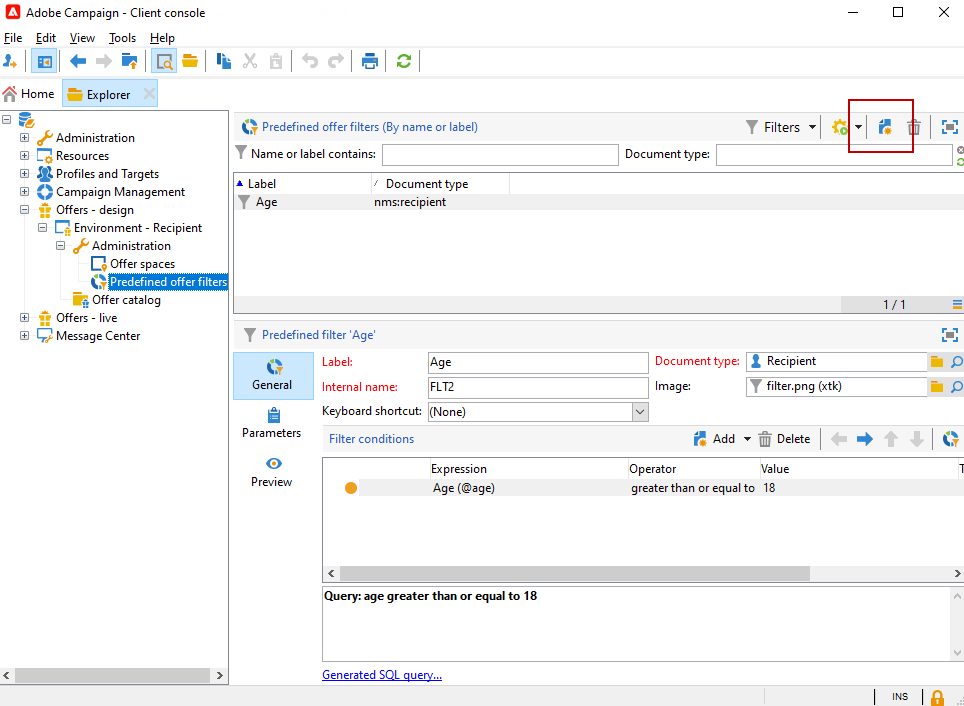
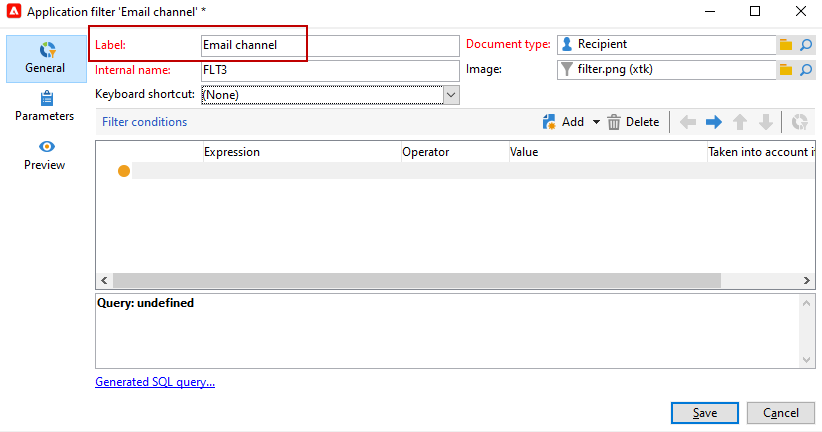

# Criar filtros predefinidos{#creating-pre-defined-filters}

Crie filtros predefinidos para definir regras de qualificação para o público-alvo que podem ser facilmente reutilizados durante a criação da oferta. Eles são específicos para cada ambiente e consideram os parâmetros de oferta.

>[!NOTE]
>
>A interface do usuário da Web do Adobe Campaign oferece uma interface simples para gerenciar e personalizar facilmente filtros predefinidos para atender às suas necessidades específicas. Crie uma vez e salve para uso futuro. Para saber mais sobre os Filtros predefinidos para a interface do usuário da Web, consulte a [documentação da interface do usuário da Web do Adobe Campaign](https://experienceleague.adobe.com/en/docs/campaign-web/v8/start/predefined-filters){target=_blank}.

Para criar um filtro predefinido, siga o seguinte processo:

1. Navegue até a pasta **[!UICONTROL Administration]** e selecione **[!UICONTROL Pre-defined offer filters]**.

   

1. Clique em **[!UICONTROL New]**.

   

1. Altere o rótulo para poder identificar o filtro mais tarde.

   

1. Selecione o campo que a condição do filtro abordará.

   

1. Selecione um operador e um valor se necessário, então salve a consulta.

   

1. Clique em **[!UICONTROL Preview]** para visualizar o resultado do filtro.

   
