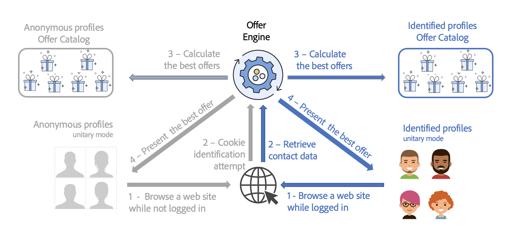

# Apresentar a melhor oferta{#interaction-present-offers}

As ofertas podem ser apresentadas em vários espaços de ofertas usando [um canal de entrada ou saída](interaction-architecture.md#interaction-types). Este capítulo detalha alguns recursos específicos para canais de entrada.

Para que uma oferta seja selecionada pelo mecanismo de Oferta, ela deve ser aprovada e estar disponível em um ambiente ativo.

Para obter mais informações, consulte [Aprovação do conteúdo da oferta](approving-and-activating-an-offer.md#approving-offer-content).

No contexto de um contato de entrada, o usuário que está navegando na página pode ser identificado pelo site ou não. O mecanismo de oferta apresenta diferentes ofertas para perfis identificados e para perfis anônimos.

Antes de poder apresentar ofertas em um canal de entrada, é necessário configurar a chamada do Mecanismo de oferta onde deseja que as ofertas sejam apresentadas. Na maioria dos casos para uma interação de entrada, esta é a página da Web.

>[!NOTE]
>
>Para interações de entrada, é necessário configurar especificamente o mecanismo de Oferta para apresentar e atualizar uma ou várias ofertas.
>
>Também é preciso habilitar o modo unitário em seus espaços de oferta. Para obter mais informações, consulte [Espaços de ofertas de interação de campanha](interaction-offer-spaces.md).
