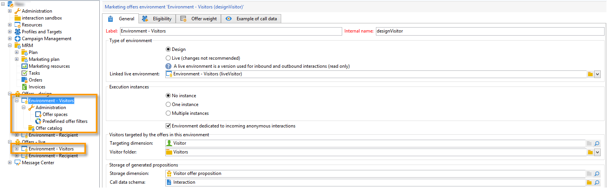
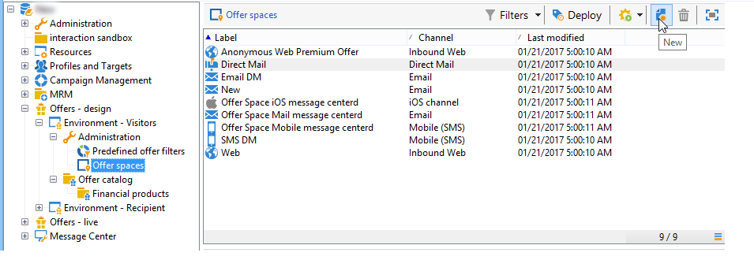
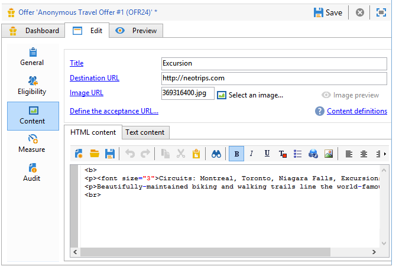
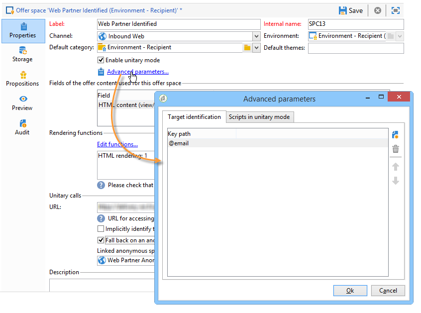

# Ofertas em um canal de entrada{#offers-on-an-inbound-channel}


## Apresentação de uma oferta a um visitante anônimo {#presenting-an-offer-to-an-anonymous-visitor}

O site Neobank deseja exibir uma oferta destinada aos visitantes não identificados que navegam na página.

Para configurar essa interação, nós vamos:

1. [Criar um ambiente anônimo](#creating-an-anonymous-environment)
1. [Criar espaços de oferta anônimos](#creating-anonymous-offer-spaces)
1. [Criar uma categoria de oferta e um tema](#creating-an-offer-category-and-a-theme)
1. [Criar ofertas anônimas.](#creating-anonymous-offers)
1. [Configurar os espaços de oferta da Web no site](#configure-the-web-offer-space-on-the-website)

### Criação de um ambiente anônimo {#creating-an-anonymous-environment}

Siga o procedimento detalhado em [Criar um ambiente de oferta](https://experienceleague.adobe.com/pt-br/docs/campaign/campaign-v8/offers/interaction-settings/interaction-env#create-an-offer-environment){target="_blank"} (documentação do Campaign v8) para criar seu ambiente anônimo com base nas dimensões de **visitantes**.

É possível obter uma estrutura de árvore contendo o novo ambiente:



### Criação de espaços de oferta anônimos {#creating-anonymous-offer-spaces}

1. No ambiente anônimo (**Visitors**), acesse o nó **[!UICONTROL Administration]** > **[!UICONTROL Spaces]**.
1. Clique em **[!UICONTROL New]** para criar um canal de chamada.

   

   >[!NOTE]
   >
   >O espaço é automaticamente vinculado ao ambiente anônimo.

1. Altere o rótulo e selecione o canal **[!UICONTROL Inbound Web]**. Também é necessário marcar a caixa **[!UICONTROL Enable unitary mode]**.

   

1. Selecione os campos de conteúdo da oferta usados para o espaço e especifique-os através da marcação da caixa relevante.

   Dessa forma, qualquer oferta que não tenha um dos seguintes elementos não será elegível para este espaço:

   * Título
   * Conteúdo HTML
   * URL da imagem,
   * URL de destino

   

1. Edite a função de renderização HTML, por exemplo:

   ```javascript
   function (imageUrl, targetUrl, shortContent, htmlSource){
         var html = "<p><b>" + shortContent + "</b></p>";
         html += "<p>" + htmlSource + "</p>";
         html += "<a _urlType='11' href='" + targetUrl + "'></a>";
         return html;
       }   
   ```

   >[!IMPORTANT]
   >
   >A função de renderização deve nomear os campos usados para o espaço na ordem em que foram selecionados anteriormente, assim as ofertas são exibidas corretamente.

   

1. Salve o espaço de oferta.

### Criação de uma categoria de oferta e um tema {#creating-an-offer-category-and-a-theme}

1. Acesse o nó **[!UICONTROL Offer catalog]** no ambiente criado anteriormente.
1. Clique com o botão direito do mouse no nó **[!UICONTROL Offer catalog]** e selecione **[!UICONTROL Create a new 'Offer category' folder]**.

   Nomeie a nova categoria, **Financial products** por exemplo.

1. Acesse a guia da categoria **[!UICONTROL Eligibility]**, insira **financing** como um tema e, em seguida, salve as alterações.

   

### Criação de ofertas anônimas {#creating-anonymous-offers}

1. Acesse a categoria recém-criada.
1. Clique em **[!UICONTROL New]**.

   

1. Selecione o modelo de oferta anônimo pronto para uso ou um modelo criado anteriormente.

   

1. Altere o rótulo e salve a oferta.

   

1. Acesse a guia **[!UICONTROL Eligibility]** e especifique o peso das ofertas de acordo com os contextos de aplicação.

   Neste exemplo, a oferta é configurada para ser exibida na home page do site como prioridade até o fim do ano.

   

1. Acesse a guia **[!UICONTROL Content]** e defina o conteúdo da oferta.

   >[!NOTE]
   >
   >É possível selecionar as **[!UICONTROL Content definitions]** para exibir a lista de elementos necessários ao espaço da Web.

   

1. Crie uma segunda oferta.

   

1. Vá para a guia **[!UICONTROL Eligibility]** e aplique o mesmo peso da primeira oferta.
1. Execute o ciclo de aprovação de cada oferta para criá-las, bem como seus espaços de ofertas aprovados, disponíveis no ambiente online.

### Configurar o espaço de ofertas no site {#configure-the-web-offer-space-on-the-website}

Para que as ofertas recém-configuradas fiquem visíveis no site, insira o código JavaScript na página HTML do site para chamar o mecanismo do Interaction (para obter mais informações, consulte [Sobre canais de entrada](https://experienceleague.adobe.com/pt-br/docs/campaign/campaign-v8/offers/inbound/interaction-present-offers){target="_blank"} (documentação do Campaign v8)).

1. Vá para a página HTML e insira um atributo @id com um valor correspondente ao nome interno do espaço de ofertas anônimo criado anteriormente (consulte [Criar espaços de oferta anônimos](#creating-anonymous-offer-spaces)), precedido por **i_**.

   

1. Insira a URL de chamada.

   

   As caixas azuis de URL acima correspondem ao nome da instância, ao nome interno do ambiente (consulte [Criação de um ambiente anônimo](#creating-an-anonymous-environment)) e ao tema vinculado à categoria ([Criação de uma categoria de oferta e um tema](#creating-an-offer-category-and-a-theme)). O último é opcional.

Quando um visitante acessa a home page do site, as ofertas com o tema de **financiamento** são exibidas como configuradas na página HTML.


Um usuário que visita a página várias vezes verá uma ou as outras ofertas na categoria desde que ambas tenham sido atribuídas a ele.

## Alternância para um ambiente anônimo no caso de contatos não identificados {#switching-to-an-anonymous-environment-in-case-of-unidentified-contacts}

A empresa Neobank gostaria de criar ofertas de marketing para dois targets diferentes. Ela quer exibir ofertas genéricas para navegadores anônimos de sites. Se um desses usuários for um cliente com identificadores fornecidos pela Neobank, a empresa gostaria de receber ofertas personalizadas assim que efetuarem logon.

Esse estudo de caso se baseia no seguinte cenário:

1. Um visitante navega no site da Neobank sem fazer logon.

   

   Três ofertas anônimas são exibidas na página: duas **Melhores Ofertas** de produtos Neobank e uma oferta de um parceiro Neobank.

   

1. O usuário, um cliente do Neobank, faz logon com suas credenciais.

   

   São exibidas três ofertas personalizadas.

   

Para implementar esse estudo de caso, você precisa ter dois ambientes de ofertas: um para interações anônimas e um com ofertas configuradas especialmente para contatos identificados. O ambiente de oferta identificado será configurado para alternar para o ambiente de oferta anônima automaticamente se o contato não estiver conectado e, portanto, não for identificado.

Siga as etapas abaixo:

* Crie um catálogo de ofertas específico para interações de entrada anônimas ao seguir as etapas:

  1. [Criação de um ambiente para contatos anônimos](#creating-an-environment-for-anonymous-contacts)
  1. [Configuração de espaços de ofertas para o ambiente anônimo](#configuring-offer-spaces-for-the-anonymous-environment)
  1. [Criação de categorias de ofertas em um ambiente anônimo](#creating-offer-categories-in-an-anonymous-environment)
  1. [Criação de ofertas para visitantes anônimos](#creating-offers-for-anonymous-visitors)

* Crie um catálogo de ofertas específico para interações de entrada identificadas executando as seguintes etapas:

  1. [Configure os espaços de oferta no ambiente identificado](#configure-the-offer-spaces-in-the-identified-environment)
  1. [Criação de categorias de ofertas em um ambiente identificado](#creating-offer-categories-in-an-identified-environment)
  1. [Criação de ofertas personalizadas](#creating-personalized-offers)

* Configure a chamada para o motor de oferta:

  1. [Configuração de espaços de ofertas na página da Web](#configuring-offer-spaces-on-the-web-page)
  1. [Especificação das configurações avançadas dos espaços de ofertas identificados](#specifying-the-advanced-settings-of-the-identified-offer-spaces)

### Criação de um ambiente para contatos anônimos {#creating-an-environment-for-anonymous-contacts}

1. Crie um ambiente de oferta para interações de entrada anônimas por meio do assistente de mapeamento de entregas (mapeamento de **Visitantes**). Para obter mais informações sobre isso, consulte [Criar um ambiente de ofertas](https://experienceleague.adobe.com/pt-br/docs/campaign/campaign-v8/offers/interaction-settings/interaction-env#create-an-offer-environment){target="_blank"} (documentação do Campaign v8).

   

### Configuração de espaços de ofertas para o ambiente anônimo {#configuring-offer-spaces-for-the-anonymous-environment}

As ofertas que devem ser apresentadas no site pertencem a duas categorias diferentes: **Best Offer** e **Partner**. Nesse exemplo, vamos criar um espaço de ofertas específico para cada categoria.

Para criar o espaço de ofertas para corresponder à categoria **Melhor Oferta** , realize o seguinte processo:

1. Na árvore do Adobe Campaign, vá para o ambiente anônimo recém-criado e adicione um espaço de ofertas.

   

1. Crie um novo espaço do tipo **[!UICONTROL Inbound web]**.

   

1. Digite um rótulo para ele: **Web Best Anonymous Offer**, por exemplo.
1. Adicione os campos de conteúdo de oferta usados para esse espaço de ofertas e configure as funções de renderização.

   

   >[!IMPORTANT]
   >
   >A função de renderização deve nomear os campos usados para o espaço na ordem em que foram selecionados anteriormente, assim as ofertas são exibidas corretamente.

1. Use o mesmo processo para criar um espaço de oferta de canal da web de entrada para corresponder à categoria **Parceiro** .

   

### Criação de categorias de ofertas em um ambiente anônimo {#creating-offer-categories-in-an-anonymous-environment}

Comece criando duas categorias de ofertas: categoria **Melhor Oferta** e categoria **Parceiro.** Cada categoria terá duas ofertas para contatos anônimos.

1. Vá para o **[!UICONTROL Offer catalog]** no ambiente anônimo recém-criado.
1. Adicione uma pasta de **[!UICONTROL Offer category]** com **Best Offer** como o rótulo.

   

1. Crie uma segunda categoria com **Parceiro** como um rótulo.

   

### Criação de ofertas para visitantes anônimos {#creating-offers-for-anonymous-visitors}

Agora vamos criar duas ofertas em cada uma das categorias criadas acima.

1. Vá para a categoria **Melhor Oferta** e crie uma oferta anônima.

   

1. Acesse a guia **[!UICONTROL Eligibility]** e especifique o peso das ofertas de acordo com os contextos de aplicação.

   

1. Acesse a guia **[!UICONTROL Content]** e defina o conteúdo da oferta.

   

1. Crie uma segunda oferta na categoria **Melhor Oferta**.

   

1. Vá para a categoria **Parceiro** e crie uma oferta anônima.
1. Acesse a guia **[!UICONTROL Content]** e defina o conteúdo da oferta.

   

1. Acesse a guia **[!UICONTROL Eligibility]** e especifique o peso das ofertas de acordo com os contextos de aplicação.

   

1. Crie uma segunda oferta para a categoria **Partner**.

   

1. Vá para a guia **[!UICONTROL Eligibility]** e aplique o mesmo peso aplicado à primeira oferta desta categoria para que as ofertas sejam exibidas sucessivamente no site.

   

1. Execute o ciclo de aprovação em cada oferta para ativá-las. Ao aprovar o conteúdo, ative o espaço de ofertas **Parceiro** ou **Melhor Oferta**, de acordo com a oferta.

### Configurar os espaços de oferta no ambiente identificado {#configure-the-offer-spaces-in-the-identified-environment}

As ofertas que você vai apresentar no site são obtidas de duas categorias diferentes: **Best Offer** e **Partner**. Neste exemplo, queremos criar um espaço específico para cada delivery.

Para criar os dois espaços de oferta, realize o mesmo procedimento dos espaços de oferta anônimos. Consulte [Configuração de espaços de ofertas para o ambiente anônimo](#configuring-offer-spaces-for-the-anonymous-environment).

1. Na árvore do Adobe Campaign, vá para o ambiente recém-criado e adicione os espaços de ofertas **Melhor Oferta** e **Parceiro**.
1. Aplique o processo detalhado em [Configurar espaços de oferta para o ambiente anônimo](#configuring-offer-spaces-for-the-anonymous-environment).

   

1. Selecione a opção **[!UICONTROL Fall back on an anonymous environment if no individuals were identified]**.

   

1. Usando a lista suspensa, selecione o espaço de ofertas da Web anônimo criado anteriormente (consulte [Configuração de espaços de ofertas para o ambiente anônimo](#configuring-offer-spaces-for-the-anonymous-environment)).

   

### Especificação das configurações avançadas dos espaços de ofertas identificados {#specifying-the-advanced-settings-of-the-identified-offer-spaces}

Neste exemplo, a identificação de contato ocorre graças ao endereço de email no banco de dados do Adobe Campaign. Para adicionar o email do destinatário ao espaço, siga o seguinte processo:

1. No ambiente identificado, vá para a pasta de espaço de ofertas.
1. Selecione o espaço de ofertas **Best Offer** e clique em **[!UICONTROL Advanced parameters]**.

   

1. Na guia **[!UICONTROL Target identification]**, clique em **[!UICONTROL Add]**.

   

1. Clique em **[!UICONTROL Edit expression]**, vá para a tabela de destinatários e selecione o campo **[!UICONTROL Email]**.

   

1. Clique em **[!UICONTROL OK]** para fechar a janela **[!UICONTROL Advanced parameters]** e finalizar a configuração do espaço de ofertas **Best Offer**.
1. Siga o mesmo processo para o espaço de ofertas do **Parceiro**.

   

### Criação de categorias de ofertas em um ambiente identificado {#creating-offer-categories-in-an-identified-environment}

Vamos criar duas categorias separadas: a categoria **Melhor oferta** e a categoria **Parceiro**, cada uma com duas ofertas personalizadas.

1. Vá para o nó **[!UICONTROL Offer catalogs]** no ambiente identificado.
1. Como no ambiente anônimo, adicione duas pastas **[!UICONTROL Offer category]** com **Melhor Oferta** e **Parceiro** como rótulos.

   

### Criação de ofertas personalizadas {#creating-personalized-offers}

Queremos criar duas ofertas personalizadas para cada categoria, ou seja, quatro ofertas.

1. Vá para a categoria **Melhor Oferta** e crie a primeira oferta personalizada.

   

1. Acesse a guia **[!UICONTROL Eligibility]** e especifique o peso das ofertas de acordo com os contextos de aplicação.

   

1. Acesse a guia **[!UICONTROL Content]** e defina o conteúdo da oferta.

   

1. Crie uma segunda oferta na categoria **Melhor Oferta**.

   

1. Vá para a categoria **Parceiro** e crie uma oferta personalizada.

   

1. Acesse a guia **[!UICONTROL Eligibility]** e especifique o peso das ofertas de acordo com os contextos de aplicação.

   

1. Crie uma segunda oferta para a categoria **Partner**.

   

1. Vá para a guia **[!UICONTROL Eligibility]** e aplique o mesmo peso aplicado à primeira oferta desta categoria para que as ofertas sejam exibidas sucessivamente no site.
1. Execute o ciclo de aprovação para cada oferta para começar a atualizá-las. Durante a aprovação do conteúdo, ative os espaços de ofertas **Parceiro** ou **Melhor Oferta**.

### Configuração de espaços de ofertas na página da Web {#configuring-offer-spaces-on-the-web-page}

O site da empresa Neobank tem três espaços para ofertas: dois para ofertas relacionadas ao banco da categoria **Melhor Oferta** e um para ofertas da categoria **Parceiro**.


Para configurar esses espaços de ofertas na página HTML do site, siga o seguinte processo:

1. No conteúdo da página HTML, insira três

   elementos com um atributo @id cujo valor permitirá que chamemos as ofertas nos vários espaços de oferta do site.

   

1. Em seguida, insira o script para definir valores de atributo.

   

   Neste exemplo, **ContBO1** e **ContBO2** recebem o valor **OsWebBestOfferIdentified**, ou seja, o nome interno do espaço de ofertas **Melhor Oferta** criado anteriormente no ambiente identificado. Os valores **CatBestOffer** e **CatBestOfferAnonym** correspondem ao nome interno das categorias **Best Offer** para ambientes anônimos e identificados.

   

   Da mesma forma, **ContPtn** recebe o valor **OSWebPartnerIdentified**, que corresponde ao nome interno do espaço de oferta do **Partner** criado no ambiente identificado. **CatPartner** e **CatPartnerAnonym** correspondem ao nome interno das categorias **Partner** para ambientes anônimos e identificados.

   

1. Atribua as informações que permitirão identificar a pessoa que faz logon no site Neobank na variável **interactionTarget**.

   Variável 

   A identificação da pessoa pode ser baseada em um cookie de navegador, um parâmetro de leitura na URL, e-mail ou identificador da pessoa. Se um campo da tabela de destinatários diferente da chave primária for usado, ele precisará ser definido nos parâmetros avançados do espaço (consulte [Especificar as configurações avançadas dos espaços de ofertas identificados](#specifying-the-advanced-settings-of-the-identified-offer-spaces)).

1. Insira a URL de chamada.

   

   A URL contém **EnvNeobankIdnRecip**, o nome interno do ambiente identificado.

Quando você abre a página da Web, o script permite chamar o mecanismo do Interaction para exibir o conteúdo de ofertas nos espaços relevantes da página da Web. Em uma única chamada ao servidor do Adobe Campaign, o mecanismo determina o ambiente, o espaço de oferta e as categorias a serem selecionadas.

Neste exemplo, o mecanismo reconhece o ambiente identificado (**EnvNeobankIdnRecip**). Identifica o espaço de oferta (**OSWebBestOfferIdentified**) e a categoria **Best Offer** (**CatBestOffer**) para os primeiros e segundo espaços de oferta na página da Web, bem como o espaço de oferta (**OSWebPartnerIdentified**) e a categoria **Partner** (**CatPartner**) para o terceiro espaço de oferta do site.

Se o mecanismo não puder identificar o destinatário, ele alternará para os espaços de oferta anônimos referenciados nos espaços de oferta identificados e em direção às categorias anônimas (**CatPartner** e **CatPartnerAnonym**) conforme especificado no script.
