# SMS em uma infraestrutura de mid-sourcing {#sms-mid}

O envio de deliveries de SMS com uma infraestrutura de mid-sourcing requer:

1. Um Operador SMS no Mid-server. [Saiba como criá-lo aqui](#sms-operator-mid)
1. Uma conta externa de SMS no servidor de marketing que usará o operador criado anteriormente. [Saiba como criá-lo aqui](#sms-external-account)
1. Uma conta externa SMPP no servidor Mid, especificando o modo de Entrega Channel e Mid-sourcing. [Saiba como criá-lo aqui](#smpp-external-account-mid)
1. Um modelo de entrega que faça referência à conta externa para simplificar o processo de envio. [Saiba como criá-lo aqui](#sms-delivery-template)

## Criar o operador SMS no Mid-server {#sms-operator-mid}

Primeiro, é necessário criar um operador SMS no Mid-server, que será usado pela conta externa de SMS no servidor de marketing.

Para criar sua operadora de SMS, siga as etapas abaixo:

1. Em **[!UICONTROL Administration]** > **[!UICONTROL Access management]** > **[!UICONTROL Operators]**, clique no **[!UICONTROL New]** e preencha o formulário na nova janela aberta.

   * **[!UICONTROL Name (login)]** e **[!UICONTROL Label]** são obrigatórios.
   * A senha não é obrigatória, mas é altamente recomendada para segurança.

   Observe que o Nome (logon) deverá ser usado posteriormente para nomear sua conta externa SMPP no servidor intermediário.

   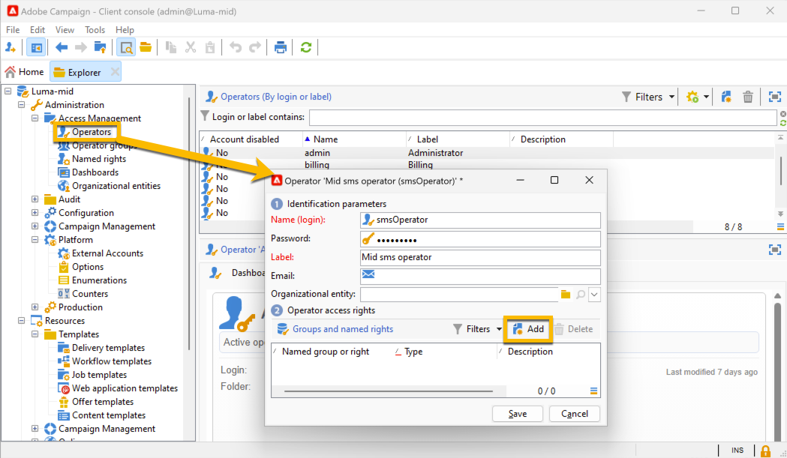{zoomable="yes"}

1. Na parte **[!UICONTROL Groups and named rights]**, clique no botão **[!UICONTROL Add]**.
Na nova janela aberta, escolha **[!UICONTROL Named rights]** na lista **[!UICONTROL Folder]** e selecione **[!UICONTROL ADMINISTRATION]** na lista direita.

1. Clique no botão **[!UICONTROL Ok]**.

   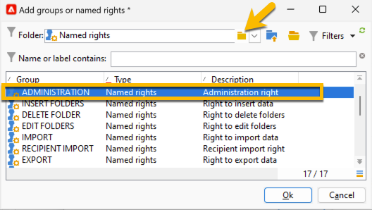{zoomable="yes"}

1. Clique no botão **[!UICONTROL Save]** para finalizar a criação do operador SMS.

   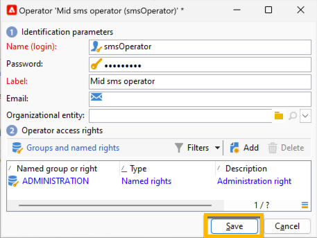{zoomable="yes"}

Você pode vê-lo na lista de operadores agora.

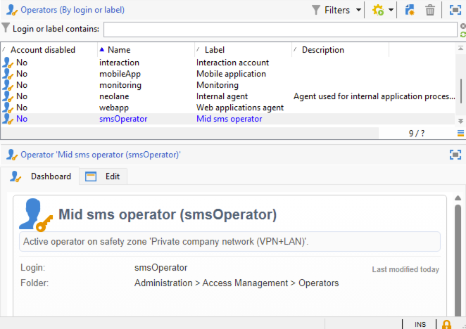{zoomable="yes"}

## Criar uma conta externa de SMS no servidor de marketing {#sms-external-account}

Em uma infraestrutura intermediária, é necessário criar uma conta externa de SMS no servidor de Marketing conforme abaixo

>[!IMPORTANT]
>
>Usar a mesma conta e senha para várias contas externas de SMS pode resultar em conflitos e sobreposição entre as contas. Saiba mais na [página de solução de problemas de SMS](smpp-connection.md#sms-troubleshooting).

1. Em **[!UICONTROL Administration]** > **[!UICONTROL Platform]** > **[!UICONTROL External Accounts]**, clique no ícone **[!UICONTROL New]**

   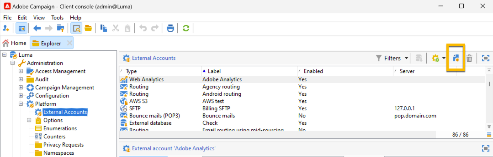{zoomable="yes"}

1. Configure o **[!UICONTROL Label]** e o **[!UICONTROL Internal name]** da sua conta externa. Defina o tipo de conta como **[!UICONTROL Routing]**, marque a caixa **[!UICONTROL Enabled]**, selecione **[!UICONTROL Mobile (SMS)]** para o canal e **[!UICONTROL Mid-sourcing]** para o modo de entrega.

   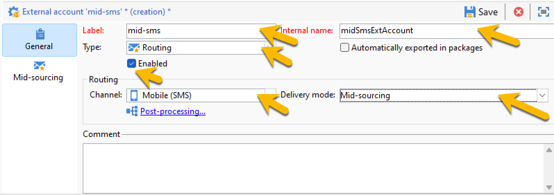{zoomable="yes"}

1. Na guia **[!UICONTROL Mid-sourcing]**, preencha o formulário com a URL do servidor mid-sourcing e o operador de SMS criado anteriormente no servidor mid-sourcing.

   Confirme a conexão clicando no botão **[!UICONTROL Test the connection]**.

   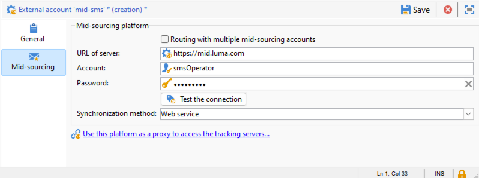{zoomable="yes"}

1. Clique em **[!UICONTROL Save]**.

## Criar uma conta externa de SMPP no mid-server {#smpp-external-account-mid}

>[!IMPORTANT]
>
>Usar a mesma conta e senha para várias contas externas de SMS pode resultar em conflitos e sobreposição entre as contas. Consulte a [Página de solução de problemas de SMS](smpp-connection.md#sms-troubleshooting).

O objetivo agora é estabelecer sua conta externa SMPP no Mid-server.

Para fazer isso, siga as etapas abaixo:

1. Em **[!UICONTROL Administration]** > **[!UICONTROL Platform]** > **[!UICONTROL External Accounts]** do Servidor intermediário, clique no ícone **[!UICONTROL New]**

1. Configure o **[!UICONTROL Label]** e o **[!UICONTROL Internal name]** da sua conta externa.

   >[!WARNING]
   >
   >Ao atribuir um nome Interno, siga a convenção de nomenclatura especificada: `SMS Operator Name_Internal Name of the Marketing SMS external account`.
   >

   Defina o tipo de conta como **[!UICONTROL Routing]**, marque a caixa **[!UICONTROL Enabled]**, selecione **[!UICONTROL Mobile (SMS)]** para o canal e **[!UICONTROL Bulk delivery]** para o modo de entrega.
   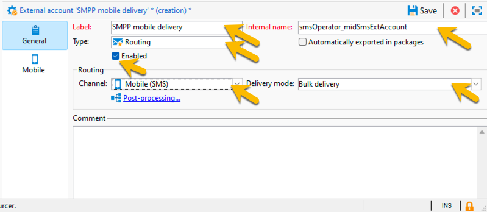{zoomable="yes"}

1. Na guia **[!UICONTROL Mobile]**, mantenha **[!UICONTROL Extended generic SMPP]** na lista suspensa **[!UICONTROL Connector]**.

   A caixa **[!UICONTROL Send messages through a dedicated process]** está marcada por padrão.

   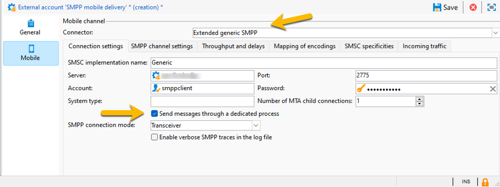{zoomable="yes"}

   Para configurar a conexão, você precisa preencher as guias deste formulário. Para obter detalhes, [saiba mais sobre a conta externa SMPP](smpp-external-account.md#smpp-connection-settings).

## Configurar o template do delivery {#sms-delivery-template}

Para facilitar a criação do delivery de SMS, crie um template do delivery de SMS no qual todas as configurações sejam referenciadas.

Em **[!UICONTROL Resources]** > **[!UICONTROL Templates]** > **[!UICONTROL Delivery templates]** no servidor de marketing, clique com o botão direito do mouse no modelo de entrega para dispositivos móveis existente e escolha **[!UICONTROL Duplicate]**.

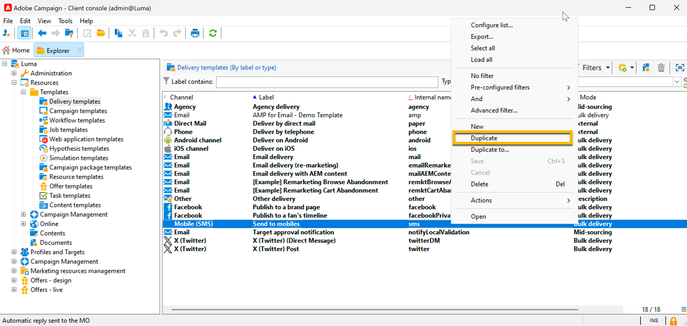{zoomable="yes"}

Altere o **[!UICONTROL Label]** e o **[!UICONTROL Internal name]** do seu modelo para reconhecê-lo facilmente, e clique no botão **[!UICONTROL Properties]**.

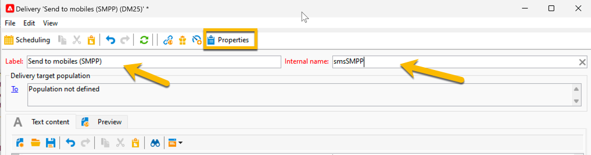{zoomable="yes"}

Na guia **[!UICONTROL General]**, em **[!UICONTROL Routing]**, selecione a conta externa SMPP.

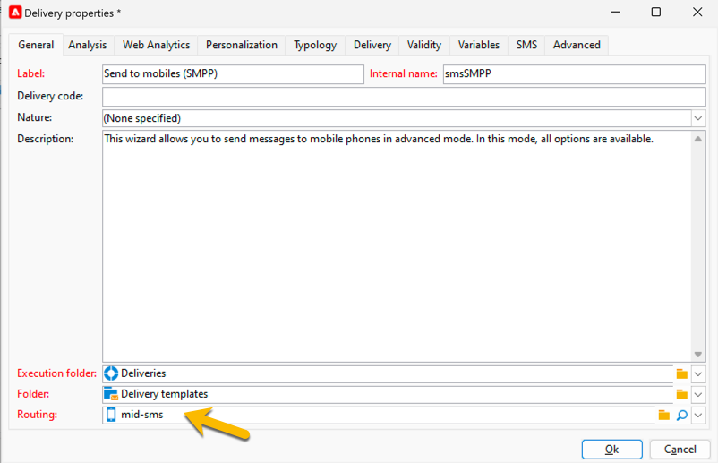{zoomable="yes"}

Na guia **[!UICONTROL SMS]**, é possível adicionar parâmetros opcionais ao modelo.

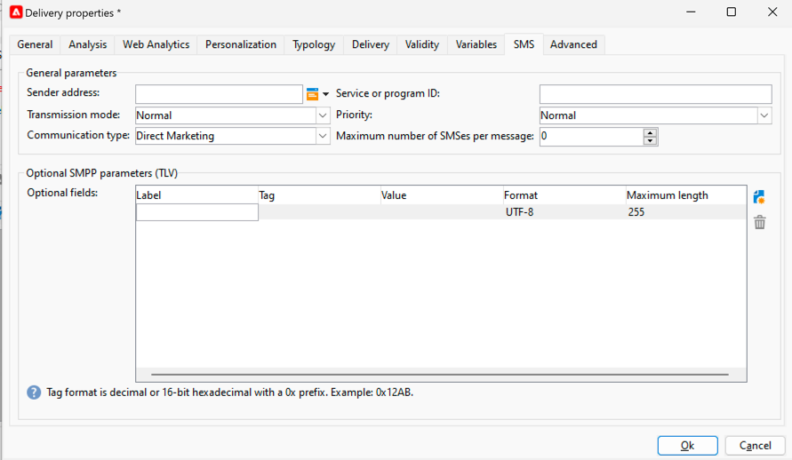{zoomable="yes"}

[Saiba mais sobre esta configuração da guia SMS](sms-delivery-settings.md).
