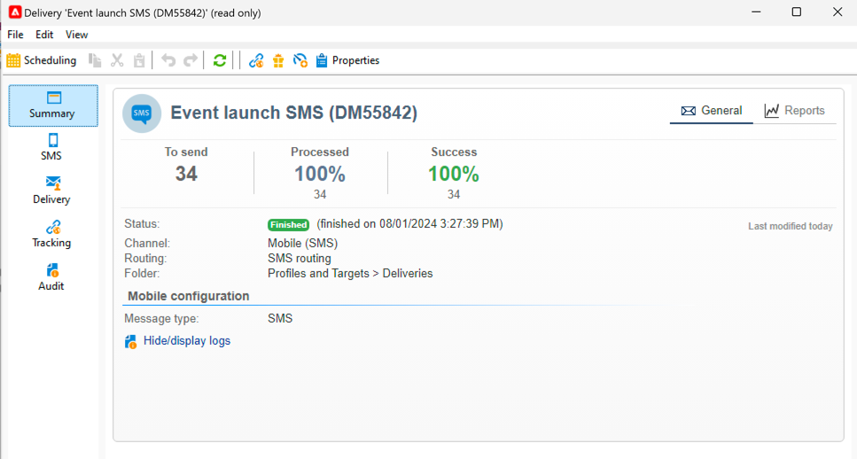
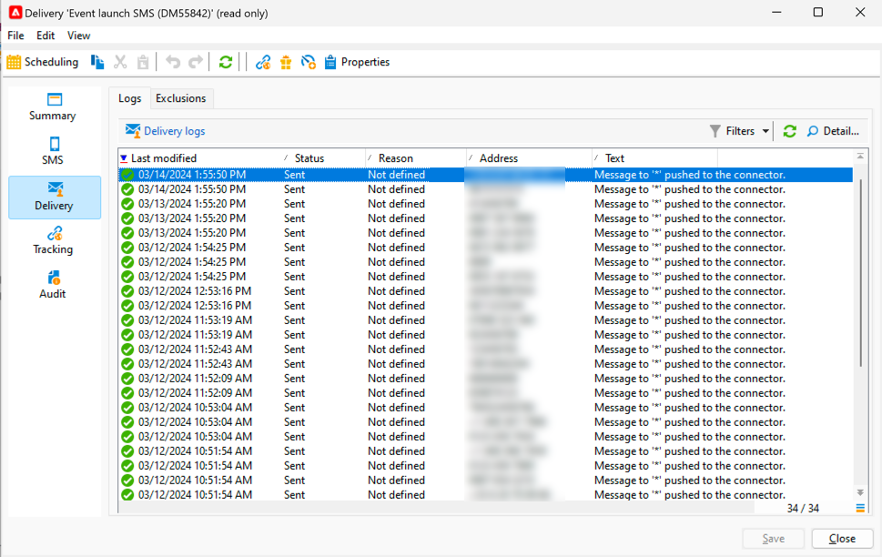
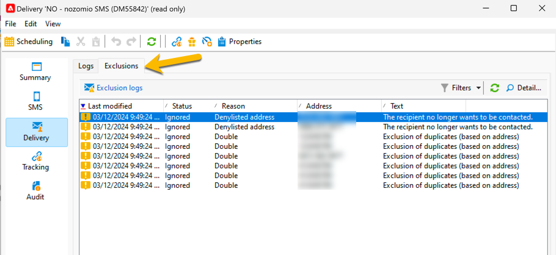
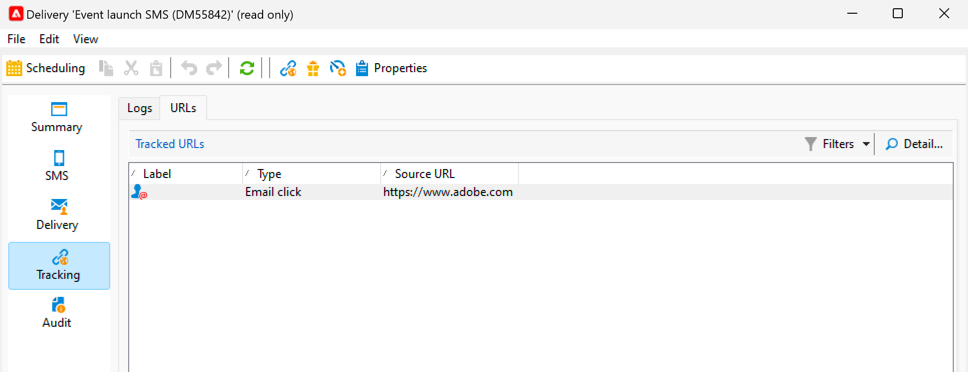
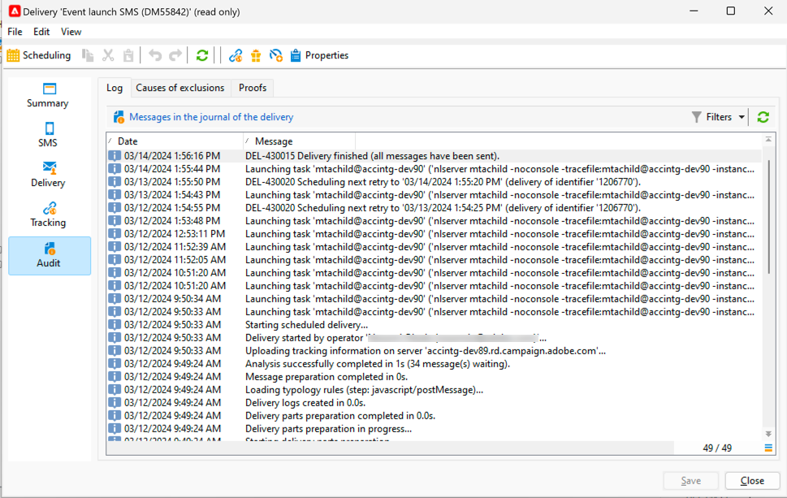

# Monitorar e rastrear um SMS

É importante monitorar o delivery de SMS para garantir que suas campanhas de marketing sejam eficientes.

Estas são as possibilidades que você tem para saber o que acontece após o envio do seu delivery

## Entender o painel de entrega do SMS

O painel do delivery fornece muitas informações sobre o SMS.

Para acessar o painel, clique duas vezes no delivery na lista de delivery.

Na guia **[!UICONTROL Summary]**, você tem os dados principais, como o número de mensagens processadas e o número de sucessos.

{zoomable="yes"}

Após o envio do SMS, a guia **[!UICONTROL SMS]**, que é sobre o conteúdo da entrega, não estará mais acessível para alteração.

Na guia **[!UICONTROL Delivery]**, você tem as informações sobre os logs de entrega. Para cada endereço contatado, você pode ver se o SMS foi enviado ou não

{zoomable="yes"}

Você pode ver na guia **[!UICONTROL Exclusions]** os detalhes sobre por que alguns endereços são excluídos do público-alvo.

{zoomable="yes"}

A guia **[!UICONTROL Tracking]** é sobre o rastreamento. Abaixo o exemplo de um URL rastreado no conteúdo do SMS.

{zoomable="yes"}

E por último, a guia **[!UICONTROL Audit]** com todos os detalhes durante a inicialização da entrega:

{zoomable="yes"}

## Entender as falhas de SMS

Os tipos de falha e os motivos para falha no SMS são os mesmos dos emails.

Saiba mais sobre [falhas de entrega](../delivery-failures.md) e, especificamente, sobre [quarentenas de SMS](../delivery-failures.md#sms-quarantines).
